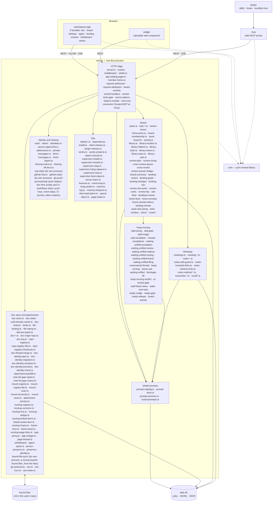
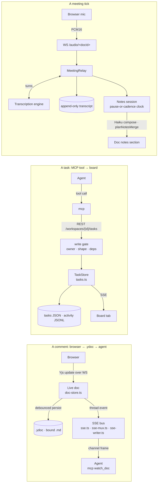

# Architecture Overview

**Goal:** one person and a team of agents share one live workspace — docs,
mockups, dev servers, a board, meetings — so giving feedback is as fast as
pointing at a thing and saying "this". This page is a map of how the code is
arranged; detail lives in the subsystem docs it links. Why it is worth building
is [docs/product/vision.md](../product/vision.md), and the guiding principles
are [principles.md](principles.md). Read this page before non-trivial work.

## The packages, and what is inside `server`

| Package | What it is | Hard constraint |
| --- | --- | --- |
| `core` | Wire types, the Yjs⇄markdown document model, anchors, attachment-set ids (`attachment.ts`), review-item rules (`review-item*.ts`, re-exported through `review-item.ts`; the quality gate's verdict predicates are `review-item-gate.ts`, the answered and withdrawn facts both read are the leaf `review-item-retired.ts`), goal arithmetic, schedule rules and their English, prompts. | Imports no other workspace package. No `node:` I/O beyond path math, no DOM. |
| `server` | The one process: data dir, the doc store, board, meetings, auth, sharing, deploys. | The only writer of durable state. Everything else asks it. |
| `workspaces-app` | The browser client, six bundles from `scripts/build.ts`. | Ships as static assets the server publishes as a numbered release. |
| `mcp` | The MCP connector agents talk to — a **client** of the server's REST and SSE. Its per-session wiring is `connector-session.ts`, which the server hosts, one per agent, working directory and default board, behind `/mcp` (`server/src/connector/`). `relay/` is the node relay: a stdio-to-`/mcp` forwarder with no tool code of its own. The full stdio child is still built, as the rollback. `server-client.ts` builds Hono's typed client (`hc`) over the child's `http()` call, one per server app or route contract. Every tool, and the plumbing that attaches, heartbeats, acks a queued row, restores watches and declares a lead, sends through it, so a renamed server field fails typecheck there. Two things stay raw on purpose: `http-client.ts` and `server-client.ts` themselves, because they are the transport `hc` sends through, and `read_doc_outline`'s GET, which has its route-table row now and has not been moved onto `hc` yet. Its import from `server` is `import type` only. | No business logic the server does not also enforce. |
| `widget` | The injectable comment widget for mockups and dev servers. The board imports it into its own bundle, and so does a markdown doc page (`doc/doc-comment-buttons.ts`, a lazy chunk; none on a `cw-embed=1` page), rather than loading `/widget.esm.js`, because that bundle carries its own Yjs and a page must run one copy (`check:client-boot` counts them). `widget-iife.ts` is only the script-tag bundle's entry: it imports `widget.ts` and exports nothing. | 40 KB gzipped (`check:widget-size`). Vanilla JS, no framework deps. |
| `components` | `@claude-workspaces/components`: components that run unchanged in a doc and on a site, packed into a tarball (`scripts/pack.ts`) a site installs with no Workspaces server. Today the street map: `map.ts` is the mount a doc tag or a site calls, over live doc state or a JSON snapshot: the board's `<StreetMap>` chunk is that mount (`workspaces-app/src/map-entry.ts` re-exports it, `mdx-street-map.ts` calls it); `draw.ts` is its Leaflet renderer. GeoJSON `layers` (line, polygon, heatmap): `layers.ts` judges the props and data against the caps, `layer-control.ts` fetches `url` layers and draws the switch list, `draw-layers.ts` puts paths on the points' canvas in declared order, and `heat.ts` is the heatmap's own canvas. `popup-node.ts` builds every popup and tooltip as text nodes, from the card shape `core/map-card.ts` reads for markers, points and layers alike. | The packed tarball names no dependency (Leaflet is bundled in) and nothing in this repo. Its source imports `core` and nothing else here. |
| `plugin` | Skills, hooks, a bundled copy of `mcp` (the full child and the node relay), and `relay/relay.swift`, the compiled relay's source. The launcher compiles it on first use. | Version bumped in two places; see CLAUDE.md. No compiled binary is ever committed. |

### Outside the packages: `templates/`

`templates/` holds starters that a new app copies into its own repository.
Nothing in `packages/` imports them, and they import nothing from it.
`templates/signin/` is a Cloudflare Worker that provides sign-in with Hono,
Better Auth and D1; its [README](../../templates/signin/README.md) covers how
to copy it. The repo's gates still cover these folders: the root workspace
installs their dependencies, the root `tsconfig.json` typechecks them, and
vitest's `node` project runs their tests.

## Layers inside each package

### `server`

**Imports point downward only** — a file may import its own layer and every layer below it, never one above.

| Layer | Where it lives (examples; the full list is [server-layers.md](server-layers.md)) | Why it is its own layer |
| --- | --- | --- |
| **HTTP** | `server.ts`, `routes/**`, `middleware/**`, `shells.ts`, `request-admission.ts`, `request-attribution.ts`, `socket-handlers.ts`, `board-sockets.ts` | The only code that knows about HTTP. Parse, admit, call one service, format. |
| **Services / stores** | `doc-store.ts` and its `doc-*.ts` collaborators, `tasks.ts` and the `task-*` stores, `review-items/**`, `home-pane.ts`, `share/**`, `auth/**`, the `meeting-*` and `notes-*` families, `sse.ts`, `activity.ts` | Owns durable state and orchestrates one change across stores and adapters. |
| **Domain (pure)** | `task-owner.ts`, `task-fields.ts`, `safe-path.ts`, `keep-moving.ts`, `stall-gate.ts`, `owner-ask.ts`, the pure `notes-*` readers | Functions over values: no clock, filesystem or socket unless passed in, so a rule is testable without a server. |
| **Adapters** | `transcribe-*.ts`, `recall*.ts`, `summarize.ts`, `deploy*.ts`, `client-release.ts`, `share/cf-api.ts`, `secret-store.ts`, `git-diff.ts`, `sentry.ts`, `outbound-fetch.ts` | One vendor or OS facility each, behind an injected interface, so a swap or a test double touches one file and no state. |
| *Composition root* | `bin.ts`, `server-config.ts`, `server-deps.ts`, `start-contract.ts` | Reads the environment once, builds adapters, wires services. Beside the stack, not on top of it. |

- **Imports point one way: `server.ts` → `routes/` → everything else.** A module that names a URL path lives under `routes/`. The rule is [.claude/rules/code-health.md](../../.claude/rules/code-health.md), "A route lives in `routes/`", and `bun run check:imports` enforces it. Another package reads `routes/` only through `routes/contracts.ts`, the typed route contracts as types.
- Where each module sits, module by module: [server-layers.md](server-layers.md), [meeting-modules.md](meeting-modules.md), [ops.md](ops.md) and [doc-store.md](doc-store.md).

### `workspaces-app`

- It layers the same way: entries, controllers, views, models, transport.
- Its models are DOM-free, which is what lets `board/board-model.ts`, `board/board-review-model.ts` and `board/board-presence-model.ts` be tested without a document.
- `doc-access.ts` is transport beside `doc-cache.ts`: it reads the access level the server sends each doc socket, so the editor locks for a view or comment member, and it tells `doc-cache-boot.ts` to drop a copy holding edits the server refused.
- Module placement: [client-and-core.md](client-and-core.md).

### `core`

- `core` is three tiers: wire types, the document model (`prose-*.ts`, `anchor/**`, `redline.ts`), then the rules both sides must compute identically (`review-item*.ts`, `effort-*.ts`, `goal-effort.ts`). `tag-props.ts` is one of those rules: the literal reader for an `.mdx` tag's props, which the page draws a component's preview with and the server reads a `<StreetMap src>` with to decide which data file a doc's visitor may fetch, so the two cannot disagree.
- It imports no other workspace package. `safe-file.ts` and `discovery-file.ts` are the exceptions to its no-I/O rule ([server-edge.md](server-edge.md)).
- Module placement: [client-and-core.md](client-and-core.md).

### `mcp`, `widget`, `components`, `plugin`

- The constraint on each is in the package table above.
- `mcp` imports from `server` with `import type` only.

## The main data flows

- **The file is the source of truth at rest, the live doc at runtime, both directions debounced.** That is why a plain `Write` to a bound file loses: the doc reasserts itself a second later while git still exits 0. Backups and conflict handling: [doc-store.md](doc-store.md).
- **A new field needs three additions: MCP tool schema, route and service.** The route is the one nothing type-checks, so add an HTTP-level test for every new parameter.
- **The audio socket is the meeting's lifecycle.** Every way it can end ends the meeting exactly once, and nothing word-rate enters the SSE buffer.
- **Flows that cross boards, servers or organizations** (the cross-board review, Home across servers, the org relay, GitHub events, a lead's push, the coach): [cross-board.md](cross-board.md).

## Subsystem docs

One line per subsystem. When you add a top-level module, add it to the diagram or to its subsystem's line here, and put the detail in the subsystem doc.

**The server and its edge**

- [server-edge.md](server-edge.md) — routes and the route table, Hono, span names, the MCP connector and relay, sign-in, fresh sign-in, clock loops, and safe file reads.
- [routes.md](routes.md) — every front-door path pattern and the gate it sits behind, generated from `route-table-rows.ts`.
- [security.md](security.md) — the trust boundaries, and which gate decides each one.
- [lead-tree-containment.md](lead-tree-containment.md) — every server path that touches a walled lead's files, and how each is contained.
- [model-prompts.md](model-prompts.md) — the voice router's model seam and the prompt catalog.
- [ops.md](ops.md) — the Ops box: health, restarts, liveness, memory, deploy.
- [supervisor.md](supervisor.md) — the health check that decides prod's server is dead, its budgets and its restart limit.

**Docs, surfaces and comments**

- [doc-store.md](doc-store.md) — document identity, mounted folders, attachment sets, bound-file sync, and the doc-store modules.
- [doc-metadata.md](doc-metadata.md) — the front-matter schema a folder declares for its docs.
- [mockups-and-apps.md](mockups-and-apps.md) — mockups and their rounds, the sandboxed frame, whiteboards, presence, dev servers.
- [comments.md](comments.md) — comments on docs, mocks and apps, and review items answered where their comment lives.
- [collaboration-core.md](collaboration-core.md) — the collaboration core, the app kit, the Worker host, and boards on the core.
- [client-and-core.md](client-and-core.md) — module placement in `workspaces-app` and `core`.

**Board, agents and keep-moving**

- [board-state.md](board-state.md) — the task store, its Yjs mirror, task projection, "Done when", compaction.
- [agent-channels.md](agent-channels.md) — which channel carries what, and when an agent is woken.
- [stall-check/](stall-check/README.md) — the stall check's design and what "working" means; [stall-detection.md](stall-detection.md) is the mechanics.
- [unfiled-ask.md](unfiled-ask.md) — whether a closing message asked the owner something with nothing filed, and the measured error rates.
- [goal-projection.md](goal-projection.md) — the goal bar, the remainder, and when a goal lands.
- [scheduled-tasks.md](scheduled-tasks.md) — a task's start rule and the loop that files each occurrence.
- [cross-board.md](cross-board.md) — flows across boards, servers and organizations.

**Voice and meetings**

- [voice-and-chat.md](voice-and-chat.md) — the widget's mic, the spoken reply, the lead chat, the planning voice, editing a page's words.
- [app-voice.md](app-voice.md) — how a sandboxed mock or app proves it is one doc on one board, so it can speak, listen and write.
- [voice-conversation-api.md](voice-conversation-api.md) — the OpenAI-format protocol any app uses to talk to one agent.
- [meeting-assistant.md](meeting-assistant.md) — live transcription and notes on a pause-or-cadence clock.
- [meeting-modules.md](meeting-modules.md) — where each meeting and notes module sits in the layers.

**Repo tooling and reference**

- [scrub-name-finder.md](scrub-name-finder.md) — the free pass that picks which pushed lines Haiku reads.
- [glossary.md](glossary.md) — the nouns, once each.
- [exceptions.md](exceptions.md) — every file over 500 lines, split or excepted; [split-plan.md](split-plan.md) is its queue and [exceptions-history.md](exceptions-history.md) holds the long reasons.
- [principles.md](principles.md) — the guiding principles and the workflows Workspaces covers.

## Adding a file

1. Name its layer first. If you cannot, it is doing two jobs.
2. Check the import direction. A service importing a route, or a model
   importing the DOM, is the error the layers exist to catch.
3. Keep it under 500 lines, or add a row to `exceptions.md` saying why —
   `bun run loc:audit` fails a file that crosses the line with no row.
4. If it is a **top-level** module — a file or directory sitting directly in
   `packages/<pkg>/src/` — change this page in the same PR: the diagram, or
   one line under its subsystem in "Subsystem docs". Put the detail in the
   subsystem doc. `bun run check:architecture` fails a PR that adds or
   removes a top-level module without changing this page.
5. In `server`, if it names a URL path it goes under `routes/`; if it runs for
   every request whatever the path, or never sees a `Request`, it stays at the
   top level. The rule and its two consequences are
   [.claude/rules/code-health.md](../../.claude/rules/code-health.md), "A route
   lives in `routes/`", and `bun run check:imports` fails the import edges it
   forbids.
