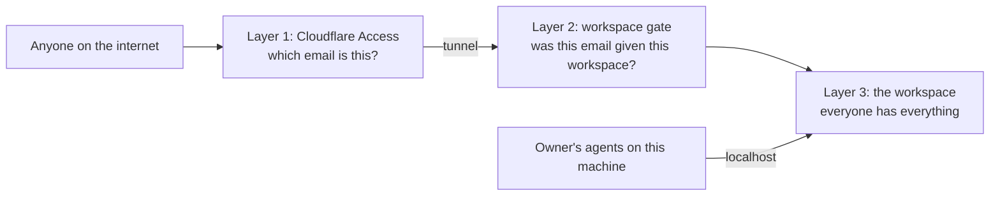

# Security model

Three sentences say most of it:

1. **Cloudflare proves who you are.** Every browser signs in through Cloudflare Access before a request reaches the server.
2. **A workspace gate checks that your email has been given access to the workspace you asked for.** Whether you arrived by share link or by the owner's own address, the server asks this on every request.
3. **Inside a workspace there are no roles yet.** Everyone who is in has everything. Finer permissions come later.

This document says where the trust boundary is, what layers stand between the internet and a workspace, and what each layer does. It describes the design as it is, not a promise that nothing was missed. File names and settings are collected at the end. Every check named there has a comment at the top of its own file saying why it exists; read that before changing it.

## The trust boundary

Claude Workspaces runs on one person's computer. That person is the owner. There is no shared service and no shared database; the boundary is the owner's machine, and the only way across it from outside is a Cloudflare tunnel the owner set up.

**Trusted:**

- The owner's machine and the programs on it: their Claude Code agents, hooks and shell, talking to the server over `localhost`.
- Cloudflare Access's verdict on who a visitor is. The server never checks a password itself.
- Cloudflare's own marker on every request it forwards (`cf-ray`). That marker alone proves a request came through the tunnel, so a tunnel visitor who claims to be `localhost` is not believed.
- Signed messages from the meeting-bot service that delivers transcripts. Its hostname sits outside the sharing master switch on purpose, so switching sharing off mid-meeting does not drop a transcript; each of its two routes works only while its own credential is set.
- ElevenLabs' servers asking for a spoken reply (setup 4 of the board mic), on the same vendor callback hostname. The route works only while setup 4 is configured, and needs both a shared secret ElevenLabs sends as a bearer token, compared in constant time, and a per-conversation token that names one open mic socket. With both it can do what speaking into that socket could do, for as long as that socket is open.

**Not trusted:**

- Anything else that arrives through the tunnel, until it has passed the layers below.
- What a request says about itself: a header naming an identity, a body naming an author, a `Host` of `localhost`. Identity comes from Cloudflare's stamp, never from the request's own claims.
- Any name that happens to point at this machine other than `localhost`: a Tailscale name, a local-network alias. These are refused, except that the Tailscale name answers the widget's own routes to a page holding a board token (below).
- Web pages running on other local ports. A dev server on this machine is not the owner, even though the owner's browser session would travel with its requests.

It is a vulnerability if anyone outside the boundary can read or change a workspace they were not given, or reach the machine's files, secrets, or deploy controls. It is also one if a Regular User on a board does something only that board's Owner may do: change who has access, or answer an ask whose answer this machine then acts on. Everything else a member does inside a board they were given is not, because on a board everyone shares the work.

## The layers

| Layer                | Question it answers                                    | Who answers it                                    | When the answer is no                         |
| -------------------- | ------------------------------------------------------ | ------------------------------------------------- | --------------------------------------------- |
| 1. Cloudflare Access | Which email is this?                                   | Cloudflare, before the request reaches the server | A sign-in page. Nothing reaches the server.   |
| 2. Workspace gate    | Was this email given the workspace this request names? | The server, on every request                      | Refused, in the same words an unknown id gets |
| 3. The workspace     | What may they do here?                                 | Nobody yet: everything is allowed                 | Not applicable until roles exist              |

The owner's own programs enter at layer 3 directly. Two things must both be true for a caller to count as a program on this machine: the request is addressed to `localhost`, and the connection starts on this machine. The tunnel connects from this machine too, and anyone can type `localhost`, so either one alone can be faked.

### Layer 1: Cloudflare proves who you are

Every hostname a browser can use sits behind a Cloudflare Access application. There are two applications, and they answer the same question for different crowds:

- **The owner's application** fronts the owner's own hostname and the collaboration hostname. It admits the owner's emails and the people the owner's identity provider allows.
- **The share application** fronts the share hostname. It admits anyone willing to receive a one-time code by email, because its only job is to establish an email. Getting through it proves nothing about workspaces.

Each application has its own audience, so a token minted for one hostname is worthless at the other. That matters most in one direction: the share application lets in anyone who can read email, so its token must open nothing at the owner's address.

There is one other way in from a browser, and it carries a token Access vouched for: the tailnet widget door, below. The server's own emailed-code sign-in is switched off while the browser hostnames are Access-only, which is the default: Access has already proven an address, so a second sign-in would ask a person to prove it twice. Turn the access-only rule off and the emailed-code sign-in comes back with it; `CW_EMAIL_CODE_SIGNIN=1` forces it on either way. A hostname listed in configuration without an Access application behind it is ignored and refused, and the server says so at boot. A hostname on no list at all is refused before any page or API runs.

A name that is on two lists resolves to the narrower grant, never the wider one.

**The board router Worker places a request; it never vouches for one.** `infra/board-router-worker/worker.js` sends a request to `<project>.<one address>` down that project's tunnel, from its `PROJECT_ORIGINS` table, and at the one address itself it reads the board id from `/workspaces/<id>/…` and sends the request to the machine that holds that board. The Host header and the Access stamp go through unchanged. A subdomain or board its tables do not list gets a 404 at the edge, any other host gets a 404, and no request falls back to a default server. Each server verifies the stamp against Cloudflare's keys itself, so a request a broken or hostile Worker routes is still refused without a valid stamp. The origin hostnames the Worker resolves to sit on no server's list, so typing one directly is refused at the host gate. Tests: `packages/server/test/board-router-subdomains.test.ts`, `board-router-worker.test.ts`, `board-router-two-servers.test.ts`.

**Each project has its own Access application, and each server admits only its own.** A project's subdomain sits behind an application of its own, so the stamps Access issues there carry that project's audience. A server checks each request's stamp against the audience of the application in front of the host it arrived on: `CF_ACCESS_HOST_AUDS` names that audience per host, and a host it does not name falls back to `CF_ACCESS_AUD` (`CfAccessOptions.hostAudiences`, `middleware/cf-access.ts`). So Bryan's stamp as one project's server receives it is refused by every other server, the Mac included, on any of its hosts, even when it arrives through the Worker. A malformed `CF_ACCESS_HOST_AUDS`, or an entry equal to the share application's audience, stops the server at boot. The one address's stamp needs one more rule, because the Worker would otherwise hand it to whichever machine holds the board: with `ONE_ADDRESS_ORIGIN` set, the Worker forwards one-address requests only to the machine that owns the one address's application and answers every other board with a 308 to its project's subdomain, so no other server ever holds a copy of that stamp. Home's feed token and the relay's tokens are sent to each project's own address, where Access stamps them with that project's audience; at the one address they would carry the wrong one. The applications and their policies are generated by `infra/access-apps/access-plan.ts` and not yet created (its README). Tests: `packages/server/test/access-per-project.test.ts` (two servers, the Worker, three applications), `cf-access-host-audiences.test.ts`, `access-apps-plan.test.ts`, and `packages/workspaces-app/test/access-per-project-browser.test.ts` (a page on one project's subdomain cannot read or write another project's board with Bryan's session).

**A cookie set above a project's own host does not reach its server.** A browser sends no cookie's Domain, so the Worker keeps cookies by name: any `__Host-` name (a browser accepts one only with no Domain), plus `cw_session`, `lf_share`, `cw_geo` and `cw_touch`, the host-only cookies the server and its page set without that prefix. Every other cookie is dropped before the request leaves, `CF_Authorization` included, since Access sends the same token as the `Cf-Access-Jwt-Assertion` header the server reads first. A parent-domain cookie under one of those four names still passes; each is signed or only labels an event, so a planted one can sign a reader out but reads nothing. On the way back the Worker removes any `Set-Cookie` that names a Domain, so one project's server cannot set a cookie that reaches its siblings. The names and the reasons are listed in the Worker's README ("Cookies").

**At the one address, the owner's session cookie travels with the board's request until `ONE_ADDRESS_ORIGIN` is set.** The cookie filter above separates subdomains; it does nothing at the one address, because every board there shares one host. With `ONE_ADDRESS_ORIGIN` unset (the default, and what runs today), the Worker forwards each one-address request to whichever machine holds the board, and `keptCookies` keeps every `__Host-` name, so the Mac's `__Host-cw_session` goes down that project machine's tunnel as well. A hostile project machine can then replay the cookie to the Mac at the one address and act as the owner there, because the Mac signed it and per-server keys do not help. It can also answer with a host-only `Set-Cookie: __Host-cw_session=…`, which `withoutDomainCookies` passes because it names no Domain, and so sign the owner out of the Mac. Setting `ONE_ADDRESS_ORIGIN` closes both: other boards get a 308 to their project's subdomain, and no other machine is sent a one-address request. Exploiting it needs a project machine that is already hostile.

### Layer 2: a workspace gate checks the email

An email gets a workspace in one of two ways:

- **The owner's emails** have every workspace, at the owner's hostname. Any other email Cloudflare admits at the owner's hostname is a visitor there, judged by the same membership as on the collaboration and share hostnames. It is never the owner.
- **A share link** gives one workspace, fixed when the link is made. The link is an invitation, not a credential. On the first visit, after Cloudflare has confirmed an email, the server checks the link is still live and records that email as a member of the workspace the link names. From then on the membership admits them, and the link is incidental. A link can also name one thing on its board to land on after sign-in — the board's Home, a task, a doc, a mock or a dev server. The landing is only a redirect and grants nothing: the page it points at meets the gate like any other request. A mint that names something not on the link's own board is refused in the same words an id that does not exist gets, and a landing that has since left the board opens the board instead. The collaboration hostname answers the same question from the workspace's own share records, which list emails and domains.

The gate runs on every request, against the workspace named in that request's own path. A request that names no workspace is refused rather than answered, so an admitted stranger learns nothing about what else exists. The one exception is `/` opened by a browser: a member gets the list of boards their own email belongs to, built from the same membership check, so it names nothing they could not already open. A browser refused a board gets one page, the same for a board they were not given and for an id that does not exist, carrying only their own address; a script gets the JSON refusal it always did. A link that is revoked, expired, or never existed shows one page, the same page in all three cases, naming no workspace and no owner.

Two verbs end the access a share link gave, and only these two. Revoking a link stops new redemptions but leaves existing members; a link is usually revoked for having been passed around, not to remove the people who used it. Removing a member ends that person's access at once, including any live connection they already had open — the same act whether it is asked for from this machine or from the board's own settings by an Owner. Neither destroys anything: a revoked link keeps its record of who redeemed it and when.

On the collaboration hostname the share records are the membership, so ending a share is what ends access there. Revoking one ends it at once for everybody its allow list admitted whom no other live share, and not the owner's own list, still admits, and closes the live connections they already had open; expiry does the same within a minute. Somebody a second share still names keeps both. Removing a share-link member never closes a collaboration-hostname connection, because that person may still be admitted there by a share.

Retiring a board is not one of them. A retired board is still a board, so its members keep reaching it; retirement stands work down, it does not take anyone's access away. To remove somebody, remove the member.

Above all of this is a master switch. Off, every outside hostname is refused before any sign-in check runs and every visitor's open connection is dropped, on the share hostname, the collaboration hostname and the owner's own hostname through the tunnel alike. The tailnet widget door is not under it: like the meeting-bot hostname, that name is outside the switch, and what holds it shut is its own short allowlist and the board token each of its routes asks for. Only a program on this machine can throw it. Every flip writes one line to the error log naming who, from which address, when and why. Turned off, it also files a decision on the owner's queue, and the owner answering "Turn back on" turns it on through the same path, logged with the owner as the actor. An agent's answer flips nothing. While the switch is off that answer can only come from this machine, because every outside hostname is refused.

One board can also be closed on its own. Its share, share-link and collaboration visitors are refused, its links admit nobody new and their open connections drop, while the master switch, every other board and the owner's own hostname stay as they were. The same local-only call does both: naming a board closes that board, and leaving the board out is the master switch.

A board can also be locked never-shareable. Closing a board refuses its visitors but still lets a link be minted, so a board holding files that must never leave the machine stayed one `share_workspace` call away from a link. A locked board refuses every mint, `share_workspace`, the share-link route and the retired `share_doc` alike, with `board_never_shareable` naming the lock and the board. It is also closed to its visitors, and reopening it with the sharing switch does not undo the lock. `POST /api/share/lock` sets and clears it, and it is loopback-only: a call carrying `cf-ray` is refused with `lock_through_the_edge`, and one from a non-loopback peer with `lock_from_the_box`, before the body is read, so the owner's own tunnel cannot unlock it either. Every change writes one line to the error log naming who, from which address and why.

### Layer 3: inside a workspace, an Owner and Regular Users

A member is a participant, not a reader. They can file and edit tasks, move status, answer review items and decisions, comment anywhere, edit any document filed on the board, file onto the board a document they can already open on it, start and join a meeting on it, name and rank the goal bands, open and read the board's settings, read its activity log, its Library list and the roster of agents working it, and turn a comment into a task. Every write is attributed to the email Cloudflare confirmed; whatever the request claims about its author is ignored.

Every membership carries a level: Owner, or Regular User. Redeeming a link makes a Regular User unless the link was minted as an Owner's, and the person whose machine this is is an Owner of every board on it without holding a membership record at all — so demoting everyone on the list still leaves the board an owner, and nobody let in from outside can take the board away from the person who made it.

An Owner can do three things a Regular User cannot. They can change who has access and at what level. They can write the board's own settings — the words every ask on this board is judged against, the prompt the effort scorer weighs, the number that limits how many builders a dispatch may run at once, and where notes are filed — because each of those is a rule the whole board then runs by, and one guest retuning it changes what everybody else's asks have to clear. Reading them stays everyone's: a criterion you cannot read is one your agents are judged against in secret. And they can drive an ask flagged owner-only: the asks whose answer this machine then acts on, running a command or handing over a credential. Driving it is more than answering it — rewording the question, taking it off the Owner's queue, overruling the gate holding it, or asking a question back where the answer goes all change the ask the Owner is expected to act on — so every write onto one is the Owner's, wherever the ask was raised. The flag belongs to the ASK, not to the surface: the same question reaches a person as a row on a ticket or as a thread on a doc, and `refuseOwnerOnlyWrite` (`share/board-role.ts`) is the single check all three route families call, because two spellings of "only the owner" agree today and the one that drifts open is the breach. Both refusals are the server's — a 403 on the route, decided from the level the request's own email holds on the board its path names — never a control the page happened not to draw. Everything else on the board is still everyone's, including reading the list of who has access, because a person who cannot see who else is here cannot know who reads what they write.

Filing a document onto the board is what makes it readable there, so a member may file only what they can already open. Pulling one in from elsewhere would be a read of another board dressed as a write.

"Everything" means everything on that board. What is outside the board is refused in the same words a guessed id gets: other boards, the list of boards, share administration (minting or revoking links, reading the links themselves, the master switch), the board's own lifecycle, the seats on it that belong to the owner's agents, and anything that names a path on the owner's machine or acts on the machine itself. Each route a member may call is written out by name, so a route added later is closed until someone opens it. A request reached through a task or goal id is resolved to its own board first, and the gate is asked about that board and no other. The files a phone fetches to put the board on its Home Screen are on the list too: the product's icons, and a manifest of the board's own that starts on the board rather than on the root page a member may not see. An installed app carries none of the browser's cookies, so its first open is a sign-in, once.

Two things on the board itself are still the owner's alone, and both spend the owner's machine rather than working the board: sending a meeting bot into a call somewhere else, and routing a spoken request to the owner's agents.

Two things a request names in its BODY rather than in its path get the same question asked of them, because no path check can see them. Filing a document onto the board is one, above. The other is a cross-reference: a task may point at another task, a document or a comment thread, and what points at a thing is shown beside it — so a reference out of the board would put a chip from a member's task onto a board nobody gave them. A member may point only at things on their own board, and a reference to something that does not exist at all is refused in the same words, so the refusal cannot be read as an answer to "is this id real". Saying that one task waits on another is the same kind of write with none of the same shape around it — a bare id in the body — and it is the sharper one, because the gate that stops a waiting task from moving reads the task it waits on and reports that task's title and state back to whoever tried. So it is asked the same question, and the report is narrowed to the asker's own board before it is sent, even for a link the owner made across boards themselves. The task still refuses to move; only the name of what is holding it is withheld.

A route a member may call still filters what it sends back. Where a task can point across boards, what comes back is narrowed to the reader's own: the tasks pointing at one of their tasks, at a document they can open, or at a thread in it. The settings withhold the notes checkout, which is a path on the owner's disk, and refuse to accept one. The Library list a member reads is built from what is filed on the board alone: no project name or path, no repo file nobody filed, no mounted folder and no word about where anything lives on disk. Opening an unfiled project file from the Library binds a file on this machine, so that verb stays the owner's. The activity log names people the way the board's live feed already does, by display name rather than by internal id, so the two doors onto the same record cannot disagree.

Document text is edited over the live-editing connection, and that is what a review is for. The board's own live doc is different: its contents are a projection the server owns, so a write arriving on it from any peer is reverted, and a member changes the board through the named routes instead.

Finer control than the two levels is not built yet. When it is, it belongs in this layer.

## Rules that guard the machine itself

**An attached dev server is a mock that answers from a port.** `attach_app` binds a dev server's origin to a board; `POST /workspaces/:ws/apps` is `trusted-local` and refuses every browser. The origin must be `http://127.0.0.1:<port>` or `http://localhost:<port>` with nothing after the port, and never this server's own port, because a proxy bound to itself would reach the trusted-local routes from loopback (`parseLoopbackOrigin`, `app-proxy.ts`). Reads under `/workspaces/:ws/apps/:id/` are GET and HEAD only, and a share or collab visitor reaches them exactly as they reach a mock: the host guard admits the path only for an app filed on the board the path names, and the workspace-scope middleware 404s an app from another board. The one write under an app is `POST /workspaces/:ws/apps/:id`, the bare address with no slash after the id: the waiting page's "Ask again" while the app is down. It reads no body, sends a fixed notice to the agent the outage already told, and `AppOutages.askAgain` refuses a repeat inside two minutes (429); the host guard admits it for a member of the board holding the app, as it admits the reads, and the sign-in write gate still applies to a browser that proved nobody. A path tail cannot name another host: leading slashes are folded away, so `//host` is a path on the bound origin; a dot segment, an encoded slash or backslash, or NUL is refused before any fetch; and the built URL must still have the bound origin (`upstreamUrl`). The dev server is addressed as itself, so it sees `Host: 127.0.0.1:<port>`, and it is sent content-negotiation and resume headers only, never the reader's cookie, Access assertion or token. Its `set-cookie`, framing and CSP headers never reach the reader; a document is served in the mock's sandboxed frame, and every other response carries a bare `sandbox` policy. **The limit that matters:** the frame's own subresource requests carry no Lax cookie, so behind Access or a share session the app's stylesheets, `<script src>` files, images and fonts are redirected to sign-in. Measured headless behind a gate refusing cookieless requests: the frame document, the relayed `fetch` and the reload event stream passed; `site.css`, a `<script src>` and an `` under the app prefix were refused. On loopback and the tailnet, where no cookie is needed, the app renders whole. An agent's `create_thread` with `find` and `path` on an app is the one place the server calls the dev server by itself: to learn which address the page is really served at, it sends up to 5 GETs with no body and no reader credential, 3s each, starting from the URL `upstreamUrl` builds, and follows a redirect only while it stays on the app's bound origin (`servedPath`, `page-thread.ts`). It only ever reaches the loopback origin the app was attached with. Tests: `packages/server/test/app-access.test.ts`, `app-routes.test.ts`, `page-thread.test.ts`, `packages/widget/test/app-reload.test.ts`.

**A create cannot take over a doc that already exists.** `POST /workspaces/<ws>/docs` treats the body's `docId` as a readable name; the server mints the doc's real id. A name that already names a doc may re-attach that doc's own file, by any spelling of it (the path, its real path, or the same repo file in another checkout), and nothing more. Another checkout includes a separate clone whose origin is the same remote: the docs are keyed by remote and repo path, so the same path in either is one doc, and which copy it reads and writes is decided by the live-copy survey (`resolveLiveCopy`), as for two worktrees. A create that would bind it to another file or change its type is refused with 409 `doc_exists`, naming the doc, before anything is changed (`createConflictWith`, `doc-create-conflict.ts`). Before this, the same name with another path repointed the doc, so a caller who knew a doc's name could move its comments and live content onto a file of its choosing, and the next write-back wrote the doc's text into that file. A mock changes round by editing the file it serves from. `attach_app` (`POST /workspaces/:ws/apps`) keeps the same rule for an origin: a name that already names a doc may attach that doc's own origin again and nothing else, and another origin or another kind of doc is 409 `doc_exists` (`routes/apps.ts`). A dev server that moves to a new port needs a new name. Tests: `packages/server/test/bind-mock-rebind.test.ts`, `doc-create-conflict.test.ts`, `app-routes.test.ts`.

**No GET changes what the server stores.** A GET is what a link preview, a prefetch, a crawler or an `` sends without anybody choosing to, and what any page may fire at this server. `packages/server/test/get-routes-change-nothing.test.ts` calls every GET row of the route table against a server holding a board, a task, a doc, a thread, a mock and a folder, then compares the data dir and the bound files byte for byte with what they held before. A new GET that writes fails it, naming the route. The one write it allows is a folder member opened for the first time, whose doc is made from the file the folder already lists. It cannot see a write that needs a query parameter no pattern carries, or one held only in memory.

**The server starts only on a data dir it was told and the port it was told.** There is no default data dir: a start that names none (`--data-dir`, or `CW_DATA_DIR`, which prod's launchd plist sets) exits before it records or serves anything, so a wrong start cannot serve or write the wrong corpus (`data-dir.ts`). No start moves to another port. Under launchd a busy port is waited for, because the port is the contract the tunnel, the discovery file and the watchdog name, and prod still listens on 8787 with no port variable set. Every other start exits and names the busy port, where it used to serve from the next free one (`start-contract.ts`, `port-bind.ts`). `bun run dev` passes `--data-dir data`; `bun run staging` passes its own data dir and port. Tests: `packages/server/test/bin-start-refusals.test.ts`, `start-contract.test.ts`, `data-dir.test.ts`, `server-config.test.ts`.

**A browser may never name a path on this machine.** Binding a file or folder, importing a task list, starting a diff review, deploying, refreshing the plugin, and reading or exercising the process's own Sentry state (`/api/sentry`, loopback only, never through the edge) all refuse every browser, signed in or not. They exist for the owner's agents on this machine, but only some of them check that the caller is on it. Deploying, the Sentry state, the mount table, the repo registry, an agent's token, watch list and event feed, and the hosted MCP connector (`/mcp`) check the connection's own address, so only a program on this machine gets through. `/mcp` also refuses anything that came through the tunnel and any page, in the same function the agent feed uses. It also asks for the agent's token, through the check the agent feed uses. On `/mcp` that check does not depend on `CW_REQUIRE_AGENT_TOKEN`. A request that names an agent, or carries a session id opened as one, is refused unless it presents that agent's token. So one session cannot read another's feed or act as it here. Its only client is the plugin's relay, which mints the token first at `GET /api/agent-token`, so no caller was left relying on a grace period. That route is loopback only. It reads the agent name from the same identity headers `/mcp` reads, and applies the rules for who may mint below. A session with no agent name needs no token, because its hosted session is its own and pools with nobody. The connector it hosts presents a token on every REST call that needs one, minted inside the server rather than over loopback. Between restarts it keeps `<dataDir>/connector-identities.json` (mode 600): each hosted agent's name, working directory, board id and plugin version, and no token or session id. The rest — binding, importing, a diff review, refreshing the plugin — are `trusted-local` and check no address. The host gate decides who reaches them. By default it admits `localhost` from a loopback address, and the owner's own hostname once Cloudflare Access has verified the owner; refreshing the plugin also refuses anything that came through the tunnel. Set `CW_ACCESS_ONLY_BROWSER_HOSTS=0` and any client on the tailnet or the local network that uses one of this machine's names reaches them too. [routes.md](routes.md) names the gate on each. The danger is a page on another local port riding the owner's session. The same routes are refused to a member of a shared board by the workspace gate as well, and that second refusal is the load-bearing one: the browser rule turns away pages, and a member could arrive from a client that is not a page.

**Page load reports are telemetry anybody who can open the page may send, and only this machine may read across boards.** A page on a board posts its load report to `POST /workspaces/:ws/load-reports`, which a share member of that board reaches as before. Home and the review page are on no board and post to `POST /api/load-reports` (`routes/load-reports.ts`), which is `trusted-local` like those two pages and refuses a share visitor in the handler too. Both take the same body and refuse the same things (`loadReportRefusal`, `page-loads.ts`): a flat object of at most 24 numbers, booleans, nulls and strings of 400 characters, 2,000 bytes in all, whose `page` is one of the seven page types. Each route takes only its own page types, so a report cannot be filed under a board it was never on. A report can raise a Sentry warning at most once per page type per board per five minutes. `GET /api/load-reports/slowest` returns the slowest load per page type over 24 h with the board id it was on. It names boards across the whole server, so it is loopback only: no `cf-ray`, a loopback socket address, no browser marks and no visitor, the refusals `/api/repos` uses. The server-wide log holds page type, board id, time and ms, nothing a reader typed, in `<dataDir>/page-loads.jsonl`, rewritten to the last day's rows past 512 KB. Tests: `packages/server/test/page-load-alarm.test.ts`, `page-loads.test.ts`, `route-table-loopback.test.ts`.

**A Mac lead can run as a macOS user of its own.** `scripts/mac-lead-users.ts`, which the owner runs and an agent never does, creates a standard user per Mac lead or helper and adds an ACL deny on `list` and `search` for that user to the owner's home, its data volume twin and every other lead's home. A file read is then refused at the folder. It only adds, never removes, and plans only what is missing. Its dry run prints each change with its exact command, and `--check` lists each folder as each user with the user's own home as the control. It walls off files and not the server: a caller on loopback is still trusted local, and the server reads a bound path as the owner, so a walled-off lead can still reach every board over HTTP until agent tokens are scoped to one board. Runbook: [docs/process/mac-lead-users.md](../process/mac-lead-users.md). Tests: `scripts/mac-lead-users.test.ts`, against a fake machine.

**A Mac lead runs inside a Seatbelt sandbox by default.** `scripts/lead-sandbox.ts`, which an agent applies with no `sudo`, writes one `sandbox-exec` profile per lead and launches the lead's `claude` under it. The profile denies reading and writing the owner's home, its data volume twin, the prod root, every other lead's projects and other projects' transcripts, and reopens the lead's own projects and what Claude Code needs to run; the config and the profiles are denied after every other rule, so a lead cannot widen its next launch. Rules are written at both ends of every symlink, because Seatbelt matches the resolved path. Like the macOS user, it walls off files and not the server, and `~/.claude` stays shared. Runbook: [docs/process/lead-sandbox.md](../process/lead-sandbox.md). Tests: `scripts/lead-sandbox.test.ts`, under the real `sandbox-exec` where it exists.

**A value the reader hands over goes to the store and nowhere else.** A review item may ask for one to six named secrets, and the reader types them into the card. They are sent to one route — `POST /workspaces/:ws/tasks/:id/review-items/:id/secrets` — which is `trusted-local`: the host guard's member allowlist does not name it, so a visitor of any role, owner included, is refused in admission before the handler exists, and the handler rebuilds the owner-only refusal behind that. The board refuses to file this shape from a share visitor at all, on every door an item arrives through, and the widget's dock — which renders on somebody else's page — never shows an owner-only ask. The route writes and never reads: nothing in this server hands a stored value back to a caller, so an agent reads its own with its own Keychain access. The server does read two such values for its own use: the ElevenLabs and Gemini keys the owner saved through a card (`claude-workspaces-secret.elevenlabs-api-key` and `claude-workspaces-secret.gemini-api-key`), which `spoken-reply/keys.ts` sends only to those two vendors and never logs or sends to a browser. The value reaches the store on **stdin**, never in an argument list, because `ps` shows every process's arguments to every user on the machine. It travels as one command line of `security -i`, not through `security`'s password prompt, which keeps only the first 128 characters and exits as if it had kept them all. Every value is checked against the store's rules before the first one is written, including a length ceiling chosen well inside that line's own measured cap, so a bad second value cannot leave a first one behind. Every write is read back, and an entry that does not match is deleted, so a name never holds a cut value an agent would take for the real one. What the item, the answer line and the activity feed record is the NAMES only.

**A permissions card is the one thing that writes the owner's Claude Code settings, and only the owner's own tap does it.** A lead files one `grant` item per task, listing every allow rule the task needs (`Bash(git push --force-with-lease:*)`). The filing gate (`packages/core/src/permission-rule.ts`) refuses bare `Bash`, a rule covering a whole tool, any rule without a letter or digit in its specifier, more than 20 rules, and any payload that mentions `deny`, `ask` or `permissions`. It also refuses these rules:

- A Bash rule whose first word runs other commands: a shell, an interpreter or a runner such as `sudo`, `xargs`, `find`, `awk` or `open`. The word is compared lower-cased and without a leading `\` or directory, because `SH` runs `sh` on a case-insensitive volume.
- A Bash rule on `git`, `npm`, `make`, `ssh`, `npx`, `bunx` and similar commands that names no subcommand, and a subcommand that runs others, such as `npm exec` or `git config`.
- A file rule that is not a path relative to the project. Absolute and home paths are refused outright, and so are `..` and any segment naming `.claude`, `.git`, `.ssh` or a shell startup file. A file rule that could edit a settings file would outlive its task, because the release removes only the lines the card wrote.

This list cannot be complete. Options after an admitted subcommand can still run commands (`git rebase --exec`), so the owner reading each line before Approve is the last check.

The card is owner-only, and a share visitor may not file it. No free-text answer door records an answer on it: `/answer` and the review-item answer route refuse it with `grant-item`, and so does the store underneath them (`review-items/answer-doors.ts`), which voice reaches. Voice is also never offered a grant or secret card to answer. So an agent cannot answer it the way it can answer an ordinary ask. It is answered at `POST /workspaces/:ws/tasks/:id/review-items/:id/grant`, which is `trusted-local` like the secrets door. The handler asks for more than trusted-local does, because trusted-local lets in every agent on this machine: the request must carry a person proof, meaning a Cloudflare Access email or the signed session cookie, and that proof must resolve to an owner id. That is the configured owner (`CW_OWNER_EMAIL`), the legacy owner id, or any id the link map resolves to one of those (`isOwnerActor`, `actor-identity.ts`). A body's claimed author, a widget token and an agent token are never read for this. The request must come from the board's own page: `Sec-Fetch-Site: same-origin` and an `Origin` equal to this server's own. Without that check, a page on another local port could send the owner's session cookie and press Approve. The task must be on the board the path names. After the body is read, the route checks again that the card is open, that an Approve's task is not closed, and that the store would record the answer, all before it touches the settings. The request must also send back the exact lines the card holds, so a card changed after it was drawn is refused with `card-changed`. On Approve, `permission-grants.ts` records the lines in a ledger in the data dir (`permission-grants.json`, mode 600), then `settings-allow-file.ts` appends them to `permissions.allow`. The write resolves symlinks, refuses a file that will not parse or whose `permissions.allow` is not a list, copies the old bytes to `<file>.cw-backup` (mode 600), writes a temp file with the original mode, checks that the original did not change underneath, and renames it into place. When the task moves to done or is archived, and at boot for any close the server missed, the server removes the lines that task added and nothing else. A line that was in the file before the card is the owner's own and is never removed. A line two open tasks share stays until the last of them closes. The settings path is set in one place (`bin.ts`): prod only, or wherever `CW_PERMISSION_SETTINGS_PATH` points. `createServer` has no default, so no test and no staging server can reach a real settings file. Without it, Approve answers 503.

**Changing anything from a browser needs a sign-in, decided by read-versus-write, not by a route list.** The gate looks at whether a request asks to change something, so a new route that writes is covered without anyone adding it. The hole is a live connection, because opening one looks like a read: the document-editing socket, the meeting-audio socket, the voice-feedback socket and the spoken-reply socket (`/workspaces/<ws>/voice/converse`) each check the sign-in themselves when they open and keep that answer for as long as the connection lasts. A fifth live connection has to do the same; nothing will catch it for you. Two of them write. The spoken-reply socket passes what the owner says to the voice router, which can set a task's status or assignee, post a comment and answer a review item, and on a doc it writes the spoken answers into that doc (`spoken-reply/interview.ts`) — only a doc the board lists, checked as the router checks a doc it is shown — and sets the server's own presence state there to put the agent's cursor on the words it asks about. Presence is unverified: any page on the doc could set the same field, so a page reads the cursor only from a state with no `user`, checks its colour and caps its words before they reach the DOM (`doc/agent-focus.ts`), and the worst a forged one does is scroll and tint the reader's view. In a meeting the page records, a "Claude, …" goes to the same router only when the upgrade's own person proof (Access email or signed session cookie, never a name or a `start` body) resolves to an owner id with `isOwnerActor({ id })`, stamped on the socket as `ownerProven`, and only from words the page's microphone heard, never the Mac-audio stream (`spoken-reply/meeting-ask.ts`); any other page hears only a planning meeting. A browser that proved nobody gets it read-only; otherwise it acts as the identity the upgrade proved or, with none, the speaker the page named at `start`. The voice-feedback socket writes comments: when its page goes without a Stop, the server writes the notes the page had not, as the identity the upgrade proved or, with none, the speaker the page named at `start`, which is the same trust a typed comment's body gets. A socket the server hung up on because its grant ended (close code 1008) writes nothing more.

**The owner is an account id, never a name.** `isOwnerActor` (`actor-identity.ts`) answers yes only for an id: `known-bryan`, the owner's email identity, or an id the link map resolves to one of those. It used to accept the display name "Bryan" too, which any share visitor, guest page or REST body can type; a name match let such an author answer the sharing notice's "Turn back on", be counted as the owner's activity, and have its words read by the coach as the owner's. A legacy string author is a name, so it is not the owner either. Tests: `packages/server/test/author-fields.test.ts`, `sharing-notice.test.ts` (a person named Bryan on another id answers "Turn back on" and nothing flips).

**The session cookie is `__Host-cw_session` over https.** The prefix makes the browser keep it only with `Secure`, `Path=/` and no `Domain`, so a page on a sibling subdomain cannot plant or overwrite it. A browser refuses a `__Host-` cookie that is not `Secure`, so over plain http (a dev server, staging on the tailnet, the test suites) it stays `cw_session`. Until 4 November 2026 (`PLAIN_SESSION_OVER_HTTPS_UNTIL`) the server also reads `cw_session` over https, so a reader signed in before the deploy stays signed in: the next request re-issues the cookie under the new name and expires the old one, and logout revokes and clears both (`auth/session.ts`, `refreshSession` in `identity-setup.ts`). Until that date a sibling subdomain can still plant a plain cookie for a signed-out reader and sign them in as somebody else. From that date the plain name is not read over https, and `auth-session.test.ts` fails the build until the fallback is deleted. Tests: `packages/server/test/auth-session.test.ts`, `auth-routes.test.ts`.

**A write from another origin never carries the reader's sign-in.** The origin policy admits a dev server on any port of this machine, because the widget on that page calls this server. A browser's site ignores the port, so a page on `localhost:3000` that asks for credentials sends the reader's Lax session cookie to `localhost:8787`; it cannot read the answer, but its write used to land as the reader. The request chain now refuses a non-GET whose `Origin` is present and is not this server's own when it carries a `Cookie` or a `Cf-Access-Jwt-Assertion` header, with 403 `cross_origin_credentials` (`crossOriginCredentialedWrite`, `middleware/browser-origin.ts`). The widget never sends credentials across origins (its fetches are `same-origin` or carry a bearer token), so its writes are unchanged. A websocket upgrade cannot be held to the same rule, because a browser attaches the cookie to every handshake and a page cannot leave it off. So each upgrade still checks the origin itself, and one from another origin that carries a `Cookie` or an Access assertion is judged as though it carried neither (`crossOriginCredentials`, `routes/upgrade-stream.ts`): where sign-in is required the editing, board, meeting, voice and spoken-reply sockets open read-only, a new mockup is not created, and no author, editor or owner is named from the cookie. A widget token on the socket (`wt2`, bound to the page origin it was minted for) is that page's own credential, so a socket carrying one is judged by it as before. It never proves the owner, so a cross-origin socket that carries one gets no owner proof either: that comes only from a cookie or an Access assertion, and the ones on this socket crossed origins. The widget offers whichever token it holds as the socket's subprotocol; a handshake refused with a dead token is retried once without it, which opens read-only (`core/src/ws-client.ts`). The app voice socket is unchanged: its credential is its own token, and a sign-in there can only refuse. Tests: `packages/server/test/cross-origin-routes.test.ts`, `cross-origin-socket-credentials.test.ts`, `cross-origin-socket-stamps.test.ts`, `widget-socket-token.test.ts`.

**Only the person a recording's socket proved can take the recording over from another window.** A phone in the background can leave its audio socket open with nothing arriving, and that socket holds the doc's meeting. A Record press or a resume on a new socket closes the old one and resumes its meeting only when both sockets' upgrades proved the same identity (`samePerson`, `meeting-takeover.ts`). The proof is what the `/audio` upgrade stamps as `data.author` from `provenAuthor()` (`request-attribution.ts`): a widget token, an Access claim or the signed session cookie, resolved to an identity id. The `start` frame's `participant` decides nothing, and neither does the meeting id it names: a takeover resumes the held meeting's own id. A socket that proved nobody, an agent on this machine included, can neither take a meeting over nor lose one to a takeover, because with no proof on either side one person cannot be told from two. A different person is refused with `already_recording`, as before, and a socket the upgrade made read-only is refused before the takeover is considered. The old page is sent an error, then its socket is closed with code 4409, so a page still awake ends rather than taking the meeting back. The transcript is appended to, never restarted. Tests: `packages/server/test/meeting-takeover.test.ts`.

**A mock's own script cannot act as the reader.** One exception is deliberate: a mock or app that loads `/widget/app-voice.js` and is opened by the owner can spend the owner's Soniox voice and listener through its app voice socket, and an app can also `say` to its own dev server (below, and [app-voice.md](app-voice.md)). Known limit: a third-party script the mock loads can read that socket's token and do the same, within the limits below. A mock is HTML somebody else wrote, usually an agent. It used to be served on the board's origin, right next to the reader's session. On staging, a mock planted threads on a different doc, and every one was attributed to the signed-in reader. Now `/workspaces/<ws>/mockups/<id>` answers a small host page holding one frame, `?cw-frame=1`. The host page runs unsandboxed on the board's origin, so it takes nothing from the mock but its `<title>` text, with `<` escaped: a browser ends a title at `</title/>`, and before that escape a mock (or an attached dev server echoing a query parameter into its title) could put a script on the host. An attached dev server's page is hosted the same way. The frame's response carries `Content-Security-Policy: sandbox` without `allow-same-origin`, so the mock runs with an opaque origin whether it is framed or opened directly. The browser then sends `Origin: null` on every write the mock tries, and the server already refuses that on writes and on sockets. The widget inside the frame still has to talk to the board, so it hands its calls to the host page. The host makes only this mock's own calls: its threads, its live socket, its voice socket, its app voice socket and the ticket items docked on it. The ids come from the server's page, never from the frame. The host keeps only `content-type` and `accept` from what the frame asked for, and never forwards a token (`mock-relay-policy.ts`). Everything it relays is stamped: `x-cw-via: mock-frame` on a request, `cw-via=mock-frame` on a socket. Agents see the stamp as "sent from inside the mock page". The frame cannot set or strip the stamp, because the host builds every request itself. A page on the board's own origin could send it, but such a page is already the reader's, and the stamp only makes its own write look less trusted. A relayed live socket is read-only. A relayed edit or re-pin reaches only a comment that was itself written from inside the mock. On the voice socket the host, not the frame, holds the microphone and passes on only text frames from the frame. On the app voice socket the host passes on every frame, binary audio included, because there the audio is the page's own; on the frame-only hostname that can be the owner's microphone, once the browser has asked them. Files served as bytes, meaning a non-HTML mock or a mounted file, get a bare `sandbox` with no scripts, because an SVG opened by its address runs its own script. PDFs are the exception: Chrome will not render a sandboxed PDF. The frame's own requests carry no cookie, and Access redirects a request without one, so the frame fetches nothing from the board by itself. The server writes every board script and stylesheet the mock names (the widget, `/widget/…` and `/app/…`, read from the builds it already serves) into the page, and voice feedback's script and each round's page come through the host. A test puts a gate that refuses cookieless requests in front of a real server and checks the frame gets past it (`widget/test/mock-access.test.ts`). An image or font the mock loads from the board, and an `/app/` module that imports files beside it, are still requested without a cookie and fail behind Access. The host asks for the microphone only on a tap it can confirm; a browser without `navigator.userActivation` gets no microphone. What stays open is what the sandbox allows by design: loading files from elsewhere, popups (which inherit the sandbox), and a tap that navigates the top page.

**A mock or app that talks holds a token for its own doc only.** `Origin: null` cannot say which page is asking, so the app voice socket (`/workspaces/<ws>/docs/<doc>/app-voice`) opens only with a token the server wrote into that frame's HTML. The server writes it only when the page loads `/widget/app-voice.js` and the reader is the owner, or the reader proved nobody where sign-in is not required. The token names the board and the doc, is signed under its own key and expires in 10 minutes. It is checked only at upgrade, and an open socket is sent a fresh token every 4 minutes, so the token's 10 minutes bound nothing; these do (`app-voice/limits.ts`). A socket closes after 10 minutes with no `speak`, `say` or audio heard, and 2 hours after it opened whatever it does. A doc has at most 3 open, and one more is closed as it opens. The whole server listens at most `CW_APP_VOICE_DAILY_LISTEN_S` seconds (default 4 hours) and speaks at most `CW_APP_VOICE_DAILY_SPEAK_CHARS` characters (default 200,000) per UTC day; past either, `speak` and `listen` answer `daily_cap` and no engine is called. The daily counts are in memory, so a restart starts the day again. The upgrade refuses a share visitor, a signed-in non-owner, a foreign origin and any token for another doc. The relay passes this token on, because it is the frame's own value in the socket's query and not one of the reader's credentials. The relay allows only this doc's `app-voice` path. The socket's `say` posts to the app's own loopback origin and carries no credentials. The full design is [app-voice.md](app-voice.md).

**Doc and comment text never runs script on the board's origin.** Everything a person or an agent writes into a doc or a comment is rendered on the board's own origin, so a script that ran from it would run as the reader. Four renderers decide that. The server's markdown parser (`core/src/prose-markdown.ts`) has no HTML node, so a tag stays the characters it was typed as, and the editor's own markdown extension has HTML off for pasted text. The editor's link extension blanks any target whose scheme is not on Tiptap's list (http, https, ftp, ftps, mailto, tel, callto, sms, cid, xmpp) or the speaker scheme. A click on a link goes through `safeLinkHref` as well. The doc page's first paint (`workspaces-app/src/doc/prose-paint.ts`), which is on screen before the editor loads, builds DOM nodes and text nodes only, with no HTML parsing, and draws a live link only through `paintedLinkHref`: an http, https or mailto target, or one with no scheme. Any other target is drawn as text. Comment text goes through `renderCommentMarkdown`, which escapes every character before it adds a fixed set of tags, and makes a link only of an http, https or mailto target. Mermaid runs at `securityLevel: 'strict'` on both of its render paths, which drops click links and handlers from the drawn SVG. Tests: `packages/workspaces-app/test/planted-script-browser.test.ts` plants a `<script>` tag, an ``, a `javascript:` link and a mermaid diagram with a script click link and a callback in a doc and in a comment on it. It opens the real doc page in headless Chromium, clicks everything they drew, and shows none of them ran and none rendered as live HTML, while a script link of the page's own still runs. With the comment escaping removed the image handler ran, and with the editor's link filter removed the doc's link kept its script target. Mermaid's two paths alone are `mermaid-strict-browser.test.ts`. The first paint's links are `prose-paint-links.test.ts`, which reads the painted DOM before any editor exists.

**Each project's frame hostname gives its attachments an origin of their own, on a domain that is not the board's.** With `CW_FRAME_ORIGIN` set to `<project>.<frame domain>`, a host page on a board hostname (`CW_FRAME_BOARD_HOSTS`, default the operator's proxied hostnames) frames its mock or app door at the same path on that hostname, with `allow-same-origin` added to the sandbox. That flag grants the frame hostname's origin, so the attachment's scripts get storage of their own, while the board's cookies and storage belong to another site. Because the frame domain is not the board's, a frame's script cannot set a cookie with the board's domain or hostname either; under the board's own domain it could have set one every board receives. The server says at boot when the frame hostname shares a domain with a board hostname (`sameSiteHosts`). A share or collaboration visitor's page keeps the opaque frame. The frame hostname is gated before host classification (`frameGate`, `frame-host.ts`): GET and HEAD only, no upgrade, and only three path families, each by `Sec-Fetch-Dest`. A mock's frame (`?cw-frame=1`) answers only as `iframe`. An app door's page answers as `iframe` with the frame flag, and its files only as `script`, `style`, `image`, `font`, media, `manifest` or `worker`, and only to a page on the same frame hostname (`Sec-Fetch-Site: same-origin`): another project's frame hostname is the same site under the frame domain, so without that check its page could load this project's scripts with this project's cookie attached. The widget's public `/widget/<name>.js` answers only as `script`. A script's own `fetch` or XHR, a top-level visit, any other path and a service worker get a 404. **Who is admitted.** Safari sends no first-party cookie to a frame on another site, so an Access sign-in cookie for the frame domain never reaches the frame (measured in WebKit on 23 October 2026). The host page therefore writes a frame ticket into the frame's address (`frame-ticket.ts`): signed under its own key domain, naming the frame hostname and the board, valid for two minutes, minted only for a page that is not a share visitor's. The frame hostname trades it for a `cw_frame` cookie (HttpOnly, Secure, `SameSite=None`, `Partitioned`, no Domain, `Path=/workspaces/<board>/`) and redirects to the address without it, with `Referrer-Policy: no-referrer`; the ticket is removed by its decoded name, so a crafted `cw%2Dft` cannot keep it in the redirect. The cookie is a second format, `fc1`, under a key domain of its own, and it ends twelve hours after the ticket was minted, however late in its two minutes the ticket is redeemed. Only a ticket redeems: a cookie value sent as a ticket is refused, and a ticket sent as a cookie is too. Only the host page mints a ticket, so no chain of redeems keeps a frame open past twelve hours from the host page's serve. Through the tunnel every request on the frame hostname needs external access on, the cookie included. Off the tunnel every request there needs a loopback peer, a ticket or cookie included, so neither opens the frames to the LAN or the tailnet, where the external-access switch does not apply. A browser request, on or off the tunnel, is admitted by that cookie for the board its path names. Without it, through the tunnel the operator's Access token and an allowlisted email still admit, and off the tunnel only a caller on this machine that sends no `Sec-Fetch-Dest`. A ticket for another frame hostname or another board, a forged one and an expired one open nothing. So that Safari can load the frame, the frame domain's Access application, where there is one, must let requests through to this check. The frame response's `frame-ancestors` names the board hostnames and never the frame hostname, so a frame-hostname page cannot frame another attachment and read it, and cannot fetch another's pages. The router sends `<project>.<frame domain>` to that project's server with the `cw_frame` cookie and no other (`FRAME_DOMAIN`, `infra/board-router-worker/`). **The limits.** One attachment's script can still load another attachment of the same project by URL and read what a same-origin subresource exposes. Storage on the frame origin is shared by every attachment of the project the operator opens: the reader's display name and guest id, written there from the seed, and the widget's unsent drafts. The frame's script never reads a ticket: the redirect that removes it is the server's 303, answered before any script in the frame runs. A ticket that leaks some other way, such as a proxy log or a pasted address, opens only this board's frames on this hostname, and buys at most twelve hours from its mint; a leaked cookie lasts no longer than the cookie it is. Neither survives a new key file. The widget's sign-in popup is not used on this path. Tests: `packages/server/test/frame-host.test.ts`, `frame-ticket.test.ts`, `board-router-frames.test.ts`; `packages/widget/test/frame-host.test.ts` opens a mock and an app door in headless Chromium with the board on `harborlight.board.localhost` and the frame on `harborlight.frames.localhost`. The board's page plants a cookie and a stored value and reads both back itself; the frame reads neither, is refused at `parent` and `top`, and the cookie its script sets on the board's domain and hostname never reaches the board, while the same cookie set from a page on the board's own domain does. The app door loads its own script and stylesheet and posts a comment typed through the widget, and a page on `riverbend.frames.localhost` held by Riverbend's board is refused the door's script.

**A doc's relative images reach its own folder and nothing else.** `GET /workspaces/<ws>/docs/<id>/assets/<path>` (`routes/doc-assets.ts`) serves a file named by a path relative to the doc's bound `.md`. It answers image extensions only, checked on the name asked for and again on where a symlink lands. Each path segment is decoded on its own and refused if it is empty, `.`, `..` or holds a separator, and the resolved real path must sit under the real path of the `.md`'s folder. An SVG goes out as an attachment with the bare `sandbox` policy, like a mounted file. The gate is `share-scope`: a visitor reaches it only on a doc the share already admits, by the same `insideSharedWorkspace` line that admits the doc's text. Each answer carries an `ETag` and `Last-Modified` and stays `no-cache`; the page adds `?v=<mtime>`, which the route ignores. The mtimes reach a visitor in the doc's `imageVersions` map (`doc-image-versions.ts`), and only for a path the route would serve: an image extension whose real path is inside the doc's folder. A peer that writes the map changes only the query its own and others' pages ask with; anything but a finite number reads as no version.

**A folder's video or image is streamed only where a lazy open could reach it.** `GET /workspaces/<ws>/attachments/<setId>/raw?path=<relPath>` (`routes/review-raw.ts`) serves the bytes a folder's video page plays, with `Accept-Ranges: bytes`, 206 for a single range and 416 for one past the end. It answers video and raster image extensions only (`mediaTypeOf`, `core/src/media-types.ts`), so it is not a second way to read a set's source files. The path goes through `resolveSetFile`, the check `context-file` runs: no `..` and nothing outside the set's root by spelling, nothing the set excludes, nothing the scan does not list (`isListedFile`, so a gitignored recording is refused like an ignored `.env`), and a symlink is judged by the file it lands on. That file must be inside the root and must itself pass the exclude and the listing (`landsOnListed`, `doc-store-workspaces.ts`), because git lists a symlink under its own name: `clip.mp4 -> .env` is refused as not listed, with the same 404 a missing file gets. A symlink to a file the folder does list is served, since it reaches nothing the tree does not already show. The gate is `share-scope`, through `raw` in `REVIEW_MEMBER_ROUTES` beside `context-file`: a visitor reaches it only on a set filed on the shared board, for GET and HEAD. A local-only set is refused off the box by the same request-chain check every `attachments/<setId>/` route meets. A media member is created with no `sourceUrl` and no binding, so its bytes never enter a `.ydoc`.

**A folder bind's `include` lists an ignored file only when it is named.** Inside a repo, what a share visitor may open is what git lists, so an ignored file stays out by default; the bind reports it in `skipped` as `gitignored`. Naming it in `include` (stored on the set as `workspaceInclude`, read back by `isListedFile`) lists it, opens it and streams it. That is the owner's agent widening the set by name, one regular file at a time. `admitIncluded` (`fs-scan.ts`) still refuses a credential name, any dotted path, a binary no surface shows, a symlink, a directory and anything outside the folder, and reports each refusal in `skipped` with its reason. The include is part of the listing cache's key, so it admits a file for the set that named it and no other set on the same root.

**A link to a folder member nobody has opened reaches what `context-file` already reaches.** A browse bind's `links` give every listed file a link, `…/docs/<setId>:<relPath>`, but only its entry is a doc yet. Two pieces make the rest open. `shareWorkspacesOf` (`board-membership.ts`) answers an id that is NOT a doc with its set and that set's boards only when a board holds the set AND `listedMember` (`doc-store-workspaces.ts`) finds the id in the set's own listing (includes and excludes applied). It touches no disk, because it runs inside admission on the main thread. A file removed since the listing still answers there for up to the listing's five-second cache, and the open after it finds the file gone and opens nothing, so its address answers 404 rather than 403. The visitor learns only that a name their share's listing held a moment ago is gone. That is the answer the opened doc will get. Any other unknown id, such as a deleted doc whose file was renamed or a file the scan leaves out, stays in no workspace, so a share visitor gets the usual `out_of_share_scope` 403 and cannot tell it from an id that exists elsewhere. An id that exists as a doc keeps its own answer, so a doc a caller named `<setId>:…` is never read as the set's. Then, below admission and above the local-only gate and the upgrades, the request chain opens the member through `openListedMember`, which calls `openContextFile`, but only for a set filed on the board in the path. A share visitor whose share covers the set could already open every listed file through `context-file`, so this widens nothing. A local-only set's member is not opened for a caller off the box, and its address then answers 404 like an id nothing holds.

**A pasted image is stored beside the doc, and only by someone who may edit it.** `POST /workspaces/<ws>/docs/<id>/assets?name=<file name>` writes the body to `images/<stem>-<8 hex>.<ext>` beside a doc bound to a markdown file (`doc-image-store.ts`). The type comes from the first bytes, PNG, JPEG, GIF or WebP, never from the header or the name, and an SVG is refused because it can carry script. The body is read with a 10 MB cap and abandoned as soon as it passes it. The name keeps only lowercase letters, digits and hyphens of the browser's file name. The file is opened with `wx`, so an existing entry, a dangling symlink included, is never overwritten and the next random suffix is tried, eight times at most. A symlinked `images/` is refused, so nothing is written outside the doc's tree. The gate is the doc's live socket's: `share-scope` admits the POST on a doc inside the shared board, and the write gate refuses a browser that has not signed in, as it makes that socket read-only.

**A board embed loads another site only from an allowlisted origin.** A doc line `::name{block="…"}` shows a frame whose address comes from the board's mapping (`core/board-embeds.ts`), stored over `PUT /workspaces/:ws/embeds`, which is trusted-local. An entry names either an app door, framed with `sandbox="allow-scripts"` exactly as a mock is, or an https origin. An origin entry is stored only when its origin is on the deployment's allowlist: `<dataDir>/embed-origins.json`, a JSON array the owner writes, read on every request so a change needs no restart, with `CW_EMBED_ORIGINS` as an override. A missing or invalid file allows none, and each entry must be an exact https origin with no path and no wildcard. A read leaves out an entry whose origin has since left the list, and the editor re-checks the origin's shape before it builds a URL. Only `block`, lowercase letters, digits and hyphens, reaches the path, and the path cannot change the host. Its frame gets `sandbox="allow-scripts allow-same-origin"`, which gives the page its own origin so its map key's referrer check passes. That is safe only because the origin is never the board's: a same-origin frame with both flags could remove its own sandbox, but a cross-origin one gains nothing on the board. The frame's own request sends no Referer (`referrerpolicy="no-referrer"`), so the board's host name never reaches the site. Its height message is taken only from that frame's window and with that origin. The board's pages set no `frame-src`, so nothing else changed to let the frame load. Tests: `packages/core/src/board-embeds.test.ts`, `packages/server/test/workspace-embeds.test.ts`, `packages/workspaces-app/test/board-embed-frames.test.ts`.

**The doc page's preview pane frames only this board's app doors.** The reader types a path beside the editor (`workspaces-app/src/doc/doc-preview-model.ts`). It is resolved against the page's own URL first, so `..` and a foreign host are judged after the parser has collapsed them. It is refused unless it keeps the board's origin and sits under `/workspaces/<ws>/apps/<id>/`, with the app id held to the board-embed rule. The frame gets `sandbox="allow-scripts"` and never `allow-same-origin`, exactly as a mock's frame does, so it can reach nothing a board embed could not. The choice is kept per doc in the reader's own `localStorage`, and no route or server state changed. Tests: `packages/workspaces-app/test/doc-preview.test.ts`.

**A doc's offline copy is kept in the reader's own browser, and only there.** The doc page keeps each markdown doc it opened in IndexedDB (`workspaces-app/src/doc-cache.ts`) so a reload paints without the network; edits made on the page are appended to a second database, `cw-doc-cache-updates`, which identity change and sign-out clear with the copies. Each copy is tagged with the identity `/api/auth/session` answered; when a session answers with a different identity every copy is deleted before anything renders, and the account menu's sign-out deletes them too. Offline, with no answer, the last confirmed identity's copies are used. A Cloudflare logout outside the app does not clear them; the next answered visit as somebody else does. The service worker (`sw.ts`, `sw-offline.ts`) keeps only the doc page's generic shell and `/app/` bundles, no doc content and no API answer, and `/sw.js` is `trusted-local`, so a share or collab visitor never installs it. No route, gate or allowlist changed. Tests: `packages/workspaces-app/test/doc-cache.test.ts`, `sw-offline.test.ts`, `doc-offline-browser.test.ts`, `doc-save-race-browser.test.ts`.

**A page on the tailnet name gets the widget and nothing else.** An app page served on this machine's Tailscale name can embed the widget, but its requests carry no Access cookie, so that name answers a short allowlist of paths (`middleware/widget-door.ts`) and 404s the rest: the bundle, the microphone chunk an embed fetches on load, the lazy voice chunk, the lazy edit chunk, the two sign-in probes, and one doc's thread list, thread verbs, live socket, recorder socket and recordings. A route added later is closed on that name by default. Everything but the four scripts needs a board widget token (`wt2`, `auth/widget-token.ts`), as a Bearer header or as the socket's subprotocol, because a browser cannot set a header on a WebSocket. The four scripts need none and can carry none: the widget cannot ask for a token before it has run, and the `<script src>` that fetches the mic, and the ones the mic fetches for the two chunks, set no header at all. All four are static, the same bytes for every embed, and already public to a share visitor, so they widen nothing; they are named one by one rather than as a `/widget/` prefix, which would have grown with the build output. A recording is the speaker's own voice, so it keeps the token like every other doc route — which is why the widget fetches a clip and plays it from a blob rather than handing its URL to an `<audio>`, an element that sends no header. The raw-words log beside the recordings is not on the door at all. Without one the answer is a 401 naming where to sign in. The sign-in is a popup on the owner's own hostname, a top-level window that Access fronts as usual. The mint there issues a token only to an email Access verified whose role on that board lets them comment — the owner or a member, since Access admits collaborators too — never on a session cookie alone (a board token outlives a logout), only for a page origin on the Tailscale name, and only for a board that exists. The token names one board and one page origin and lives a day. The server checks it against the path's board, the request's own `Origin`, the person's session watermark and their role on the board, so signing everyone out, or removing that person from the board, kills it. A socket is checked once when it opens, so a sweep hangs up a door socket whose token has died within a minute — either of them, the live doc's and the recorder's, the second of which spends a transcription engine for as long as it stays open and belongs to no document's connection set for the sweep to find by itself. The door's socket is read-only. The door refuses a doc on another board and any existing doc that is not a page doc (a mock); a doc id not used yet opens as one, which is how the widget starts a new page. The widget accepts the token only from a message sent by the sign-in origin. A stolen token lets its holder read and comment on that one board's page docs as the person it names, from a page on the Tailscale name, for up to a day. The door never admits a request that came through Cloudflare. The Tailscale name is discovered at boot, not configured; with the Access-only rule off, that name is fully local as before and the door does not apply. If the Access login page sets `Cross-Origin-Opener-Policy`, the popup loses its opener and cannot hand the token back. That would break sign-in, not open anything.

**A mounted folder may be narrower than its project.** A project's mounted
files are served to a board member over the tunnel or the tailnet by default,
and marking the project `local-only` keeps every one of them on the machine.
One folder can be marked instead, so a project holding an outside party's
material shares its harmless folders and not that one. The answer a file is
served against is the NARROWER of its folder's setting and its project's, so
marking the project can never be undone a folder at a time, and a folder
nobody marked follows the project exactly as every mount did before folders
had a setting of their own. It is decided in two places, both against the
combined answer: the address a file answers at (`routes/mounts.ts`) and the
Library listing that would carry its NAME off the machine first
(`routes/workspace-library.ts`, which drops a hidden folder from both the
mount listing and the project's own git listing).

**An attached folder can be local-only too.** A folder bound with
`attach_folder` has no project around it, so it carries its own privacy, set
by passing `privacy: 'local-only'` on the bind. Its files and their names are
then served to a caller on this machine alone: a loopback peer with no
`cf-ray`, the rule a local-only mount is served under. A share-link visitor, a
collaboration visitor, the owner through the tunnel and a page on the tailnet
are all refused with `local_only`. The check is one function
(`addressesLocalOnlySet` in `attachment-privacy.ts`) that runs right after
admission and before the websocket upgrades, on every address under a board
that names the set or one of its files: the file list and tree, a file's
content, socket and threads, and an ask derived from a file's thread. The
Library listing and the board's review-item queue drop the set's names for
off-box callers. The answer to every bind names the set's privacy, and says
`shareable` when the flag was left out. Leaving it out on a later bind keeps
the set's current setting, so a re-bind never widens a local-only set. The
record fails closed: an `attachment-privacy.json` that cannot be read serves
every set as local-only and refuses changes until it is fixed. Three surfaces
still carry a file's name or title off the machine without passing the check:
the board brief's text, the activity feed and a task's link chips. Opening
any of them reaches the refusal.

**A shared folder shows only what git lists.** A reviewer can open a file from a shared folder or diff review only if `git ls-files` lists it, so ignored files and anything under `.git` never appear. Files whose names look like credentials (`.env`, `*.pem`, `*.key`, `id_*` and their relatives) are refused even when untracked. Outside a git checkout, every dotfile is hidden. A symlink git lists is judged by the file it points at, which must be inside the folder and listed too. So a link to an ignored or credential-named file, or to a file outside the folder, opens nothing, is never the doc a folder opens with, and is left out of a working-tree diff review, named in the bind's `skipped` as `symlink-target`. A pinned diff shows the link's own text. Outside a checkout no symlink is listed at all.

**An agent's own event feed is that agent's to read.** Everything one session subscribes to — every board, document and comment thread it watches — arrives on a single connection addressed by that agent's name, and the list of what is on it is a second door onto the same thing. The name is written on the board for everyone in it to see, so the address was never a secret and cannot be the check. Both doors are now served only to a process on this machine that is not a browser and did not arrive through the edge, and only against a token the server mints for that one agent and no other.

**Who may mint that token.** The server mints an agent's token only for a process running under that agent's own Claude Code session. It finds the process holding the other end of the connection and walks up to the nearest process named `claude`, the session, and reads the agent name that session was launched with. A session launched with no name is read through its direct child instead, the process an MCP server runs as, which covers a name set in MCP-server config; anything further down, such as a command run through the session's shell, is refused. A caller with no session above it is refused, and so is the server calling itself; the sessions the server hosts at `/mcp` get their tokens in-process. Each refusal writes one line to the log naming the agent and the reason. So a named session, or any command it runs, cannot mint another agent's token, and renaming the command (`CW_AGENT_NAME=<other> curl …`) changes nothing, because the check reads the session, not the command. An unnamed session's commands get no token at all. A process the session starts directly, which an MCP server is, still speaks for whatever name it carries; a command that replaces the session's shell with itself (`exec`) is such a process, and the check cannot tell it apart. What this cannot do is separate two programs the owner is already running: they share one account and one trust zone, so a process that reads the server's key file can compute any token, and one that launches a new session under another agent's name is that agent as far as the machine can tell. Nothing here should be read as claiming otherwise.

**The switch.** `CW_REQUIRE_AGENT_TOKEN` decides what happens to a caller that presents no token. Off, it is served and the log names it once per agent and door; on, it is refused. A current plugin sends no token only when its mint failed, and then asks again on the next call; a refused REST call is retried once with the token. Read the log for refused mints and tokenless callers before turning the switch on: every session named there is one the switch would lock out of its own feed.

**Where a person was stays on this server.** When a browser allows it, the analytics rows its actions write carry a location rounded to about a kilometre, read from a cookie the page sets and rounded again on arrival. It is written to the log file only, never onto the live event stream. It is removed from every row a share visitor's Activity tab reads (`share/redact-board-events.ts`), never logged, and never passed to Sentry or to a model. The same module strips the actor id from the two review-item measurement rows (viewed and answered) before a visitor sees them: those ids derive from an email address, and a visitor has no use for a subtraction's author. The browser asks at most once per device, and a refusal is remembered.

**What a visitor is sent is built from a list of allowed fields, not forbidden ones.** Review links are rewritten to the visitor's own workspace, paths on this machine are removed, and the record of which agents are present names exactly the fields a visitor gets. A field added later is withheld until someone adds it to the list.

**An inbox poster's post is the only way message text enters the server, and it may close one task.** `POST /inbox/rows` (`routes/inbox.ts`) answers only a process on this machine, never through the tunnel or from a page, that holds the agent token of a poster the inbox config names: the reader (`readerAgentId`) or an agent in `posterAgentIds`, such as Job Search posting its recruiter picks. The token is required even with `CW_REQUIRE_AGENT_TOKEN` off, and every poster's rows pass the same per-field checks. A post may also name the scheduled run it answers (`run: { workspaceId, taskId }`), and the server moves that task to done through the ordinary transition gate only when it is a scheduled-run instance on the board named, owned by the posting agent, open and not archived (`inbox/run-close.ts`); any other task is refused by name and nothing moves. A post may also take rows off Bryan's list (`dismiss: [{ dedupeKey, reason }]`) with the one reason `handled-elsewhere`: the row moves to dismissed with a history entry `by: agent` naming the poster, nothing is deleted, a new message on the thread does not bring it back, and Bryan's Bring back or Undo does. A poster can neither read a message, nor snooze, answer or reply to one, nor dismiss as spam. A row names its sender by the source's own id (`senderId`); the server hashes it into the row's sender key and never stores, logs or returns the id (`inbox/sender-key.ts`). Reading a message and moving a row are the owner's alone, signed in, from the front page's own origin. The front page `/` draws the Incoming Messages lines only for a request whose person proof names the owner (`routes/shell-static.ts`); an agent reading `/` from this machine proves nobody and gets the page without them.

**Bryan's Send from Incoming Messages is the one way this server posts as him.** `POST /inbox/rows/:id/reply` (`routes/inbox.ts`) takes the same owner gate as the body read and the taps: a person proof naming the owner, from the front page's own origin, refused to every agent (the reader included) and every share or collab visitor. The request holds the words and a nonce and nothing else; a body naming a thread, an address or a channel is refused. The destination is rebuilt from the stored row and today's inbox config (`inbox/reply-target.ts`), so a Slack row whose stored host the config no longer names is refused. Email goes to the newest inbound sender's one `From` address in the same Gmail thread; Slack goes to the stored thread with Bryan's user token for that workspace, after `auth.test` confirms the token belongs to that host; a token saved on the secret card, which names no workspace, is used only for the host `auth.test` names. A nonce repeated on a row within 24 hours gets the first answer back and sends nothing; at most 30 sends go out an hour, counted from `<dataDir>/inbox/sends.json` (mode 600), which also keeps the sent words under the body's page-only rules. Texts are never sent by the server: the page builds an `sms:` link from the row's own number and Bryan sends it in Messages.

**The coach reads what the owner reads and writes, sends it to the Anthropic API, and skips the boards that must not go there.** Every page route in `routes/coach.ts` (`/coach/setup`, `/coach/review`, `/coach/prefs`, `/coach/boards`, `/coach/here`, `/coach/moments/:id/answer` and the `GET /coach/stream`) takes the inbox taps' gate: a person proof naming the owner, a same-origin fetch mark, and on a POST this server's own origin; it is refused to every agent and every share or collab visitor. `/coach/here` is sent by every board and doc page, so anyone but the owner gets an empty 204 that tells the page to stop, before anything is read; the owner's cookie from another site is still refused. It names a board and doc that must exist on this server, or one of two pages that name no board (`page: 'home' | 'review'`, which carries only `visible`), and a body over 8,000 bytes is refused.

What leaves the server, exactly: the heading in view (up to 120 characters) and up to 600 characters of the passage in view, which can be anyone's writing on that page, not only his; each paragraph he writes (up to 1,500); the text of his own comments and replies (up to 1,500); and the titles and board names of the pages they are on; and, per attached Claude Code session he typed a prompt into, that board's id and name, the repo's folder name (the last part of the session's working directory, or the repo above `.claude/worktrees/`), its active minutes and its counts of typed prompts and turn ends (`coach/session-minutes.ts`), and, per typed prompt and turn end in it, one line of at most 120 characters saying what was asked or done, with the mark's own text beside it: up to 2,000 characters a mark and 40,000 a digest (`DIGEST_TEXT_CHARS`), past which the oldest marks keep only their line. Those lines are written by Haiku, at most 40 marks a call and five calls a digest (`coach/summary.ts`, the dedicated summary key through `resolveKeySlotFrom`, off with `CW_COACH_SUMMARIES=0`), which is sent the first 800 characters of each prompt's reduced text and each turn's closing message; with no key or a failed call the line is the text's own first 120 characters. The session id and the rest of the path never reach the coach session; the notes route reads `cwd` off the Stop hook's body only to hand the coach that folder name. A background tab sends no view. Each goes in one frame addressed to the Coach board's lead agent and to no other stream. That agent is a Claude Code session, so every frame becomes part of a prompt sent to the Anthropic API under that session's key. Whoever holds the lead seat receives it, and any agent on this machine can take the seat, so the frames stay inside the one trust zone every local session already shares until the session sends them on; with no lead holding a stream, the closed windows wait in `<dataDir>/coach/backlog.json` (mode 600; at most 96 windows and none older than 48 hours, `coach/backlog.ts`) and go to the lead as one digest when its stream opens. Moments' answers, the setting and the morning wake-up are not held.

**A prompt mark says whether a person typed the prompt, and what a typed one said.** The plugin's UserPromptSubmit hook (`packages/plugin/hooks/prompt-mark.ts`) reads each prompt on the machine and decides from its opening wrapper whether the harness injected it; a `claude -p` or Agent SDK run (`CLAUDE_CODE_ENTRYPOINT` of `sdk-cli`, `sdk-ts` or `sdk-py` with no `CLAUDE_CODE_BRIDGE_SESSION_ID`) counts as injected. It posts `typed`, the session id, the working directory, a time and, for a typed prompt only, its text reduced the way a turn note is (`note-redact.ts`: URLs, host paths, token-shaped words and emails replaced) and cut to 2,000 characters, to `POST /workspaces/:ws/agents/:agent/prompts` (`routes/prompt-marks.ts`). The route refuses a `text` that is not a string or is over 4,000 characters (400 `bad-text`). A session launched with no board finds one by `GET /api/voice/agents`, the voice page's list (`trusted-local`), and posts to the one board where an agent of its name holds a stream; none or two, and it posts nothing (`packages/plugin/hooks/lib/joined-board.ts`). The route is `trusted-local` and refuses share visitors. It refuses a shared agent name and a session id over 200 characters, and replaces a time outside the notes route's window with its own clock. It checks no agent token. The mark moves an in-memory count of that session's active minutes, and only the repo's folder name is kept from the working directory; the text is held with the digest window, so it is on disk in the coach's backlog file until the window is read. A mark from a board that is off for the coach, or from the coach's own session, is dropped. Any process on this machine can post a mark under any agent name, so a forged one can change the minutes the digest reports, and a forged typed mark's text reaches the coach session as written. Tests: `packages/server/test/prompt-marks-route.test.ts`, `packages/plugin/test/prompt-mark.test.ts`.

Nothing is sent from a board that is off for the coach (`coach/exclusion.ts`), not even its title: one whose attachment set or project is `local-only`, or holds a doc that is; one with the sharing lock on; and one he turned off with "Coach off for this board". A board any member, share or link besides the owner can reach is not off (the owner, 2026-10-16: the coach should see everything he does and sees); what reaches the coach from it is his own comments, replies and opens, the pages he views there, which can show others' writing, and his sessions' prompts. A doc is off when it is local-only itself or any board holding it is off. A doc's project is found from the repo half of its key (`repoKey\0relPath`), so a doc bound from a `local-only` project is off, and so is every board holding it. From the coach's first commit (ced6456d7, 2026-10-04) until this check was fixed, the project store was asked about the whole doc key, which names no project, so no doc was off for its project's privacy, and no board was off for holding one. A mount marked `local-only` inside a project that is not does not make its docs off: only the project's setting and the attachment set's are read. Tests: `coach-exclusion.test.ts`, `coach-local-only-project.test.ts`. A check that throws counts as off, and so does every board while the coach's state file cannot be read. A day's events stop at 400 (`DAILY_EVENT_LIMIT`), and the front page says the coach is paused.

**The coverage report is counts, for this machine.** `GET /coach/coverage?date=YYYY-MM-DD&timeZone=` (`routes/coach.ts`, `coach/coverage.ts`) refuses share visitors, then takes only a loopback caller with no `cf-ray` and no browser marks (`refuseNonLocalAgentCaller`). The date must be a real calendar day and the zone a known IANA zone, or it answers 400. It answers, per hour of that local day, how many signals the owner sent by source and kind, how many the coach dropped by reason, and what the delivered digests carried by source and kind with their minutes: numbers keyed by fixed words, never text, titles, paths or ids. The source of a page signal or an activity row is the device kind `event-origin.ts` reads from the request's user agent; a prompt mark's is `remote: true`, which the hook sends when `CLAUDE_CODE_BRIDGE_SESSION_ID` is set and the route refuses as anything but a boolean (400 `bad-remote`). The counts are in `<dataDir>/coach/coverage.json`, mode 600, at most 192 hours. Tests: `coach-coverage-report.test.ts`, `coach-routes.test.ts`, `coach-coverage.test.ts`.

The session raises a moment on `POST /coach/moments`, which takes only a loopback caller with no `cf-ray` and no browser marks (`refuseNonLocalAgentCaller`; there is no token), and is checked before any page sees it: it must copy at least three words in order from the goal it names, and only one moment is open at a time. Rows not marked `isOwner` are never read. The goals and memory docs are files under the data dir, mode 600, on a board of their own.

**The coach's card reaches only the owner's own pages, and hides on a board that is off.** `GET /coach/stream?workspaceId=&docId=` (`routes/coach.ts`, `coach/hub.ts`) takes the page-route gate above: a person proof naming the owner and a same-origin fetch mark, refused to every agent and every share or collab visitor. It is a stream of its own, not a board channel, because a board channel reaches every member. The two parameters say where the page is. A board must exist on this server and a doc must be on that board, or the stream is refused with a 400; with neither, the page is the front page. The stream carries only the open moment (its id, time, the coach's name, its line and the goal it names) and its clearing. A page on a board or doc that is off for the coach, by the same check as above (`placeIsOff`, `coach/exclusion.ts`), is never sent the moment, and a check that throws counts as off. When a board is turned off or back on, or a visible page on an off board reports in, every open page is told again: the moment where it may show, a clear where it may not, so a card already drawn there is taken down. The front page names no board, so it always shows the card. At most 24 streams are open at once, and the oldest is closed past that. Tests: `packages/server/test/coach-hub.test.ts`, `coach-routes.test.ts`.

**In a call the meeting bot is in, the participant email it reports is what makes a speaker the owner.** Unless `CW_MEETING_CLAUDE=0`, a final turn that opens with "Claude," is answered aloud into the call, and the answer runs as the owner (`meeting-claude.ts`). There the only proof of who spoke is the email Recall reports for that participant, matched against `CW_OWNER_EMAIL`. A meeting the page records instead has its own gate, the upgrade's person proof (`ownerProven`, described with the spoken-reply socket above), and on that page anyone the microphone hears counts as the owner. A display name never counts, and a participant with no email, or a server with no owner email set, gets silence. This server does not verify that email itself, so the check is only as strong as the meeting platform's account sign-in. The feature is on by default wherever an owner email and a Recall key are set (the owner, 2026-10-02); `CW_MEETING_CLAUDE=0` turns it off, and the boot log says which. The owner's words are not the only input: the answer is given the meeting's notes and the last two minutes of the call's speech (`voice-meeting-context.ts`), which every participant shapes. A guest cannot start an answer, but can steer one the owner starts, including an action the fast path takes.

**One agent hears every board's new asks, and only it may rank them.** The plan board's lead (the board `review-plan.json` names) receives one addressed `workspace.new_asks` frame per 10-minute window listing each review item filed on any other board: its board, row, queue key, headline and filing time. The detail, options and every comment's words are never sent (`ask-feed.ts`). Every board is in the feed, including one that is off for the coach (`coach/exclusion.ts`: local-only, sharing-locked, or turned off with "Coach off for this board"): the lead has the same visibility the owner has (the owner, 2026-10-23: "They should have the same visibility I do"), and the coach's exclusion is the coach's alone. That holds for a stream on this machine. A lead stream opened through the tunnel or from a peer that is not loopback, such as a lead on another machine holding an `at2`, gets the frame without any ask whose board or doc is local-only, and no frame when nothing else is left (`offBoxAskView`, applied to the board stream and the agent stream alike, live and replayed), because `local-only` promises the content stays on this machine. A board holding a local-only folder bind counts as local-only. A sharing-locked or coach-off board's asks still reach a remote lead. `POST /api/review-queue/rank` (`routes/review-queue.ts`) refuses share visitors, then takes only a loopback caller with no `cf-ray`, no browser marks and the agent token of the agent it names (`authorizeAgentCaller`, `requireToken: true`), then refuses any agent but the plan board's seated lead (403 `not-plan-lead`) before it looks up the key. The rank and tag reach an item on any board, by the same decision. The feed carries the headlines of asks filed on shared boards, including asks a member's agent filed. The rank write sends nothing anywhere: the lead already holds the key from its own feed or the queue, the answer carries only the key, rank and tag it sent, and the values are read only on the owner's Home. A key that names no open item answers 404 `not-found`. Tests: `packages/server/test/lead-sees-every-board.test.ts`, `review-rank-routes.test.ts`. The rank is a whole number from 1 to 10000, or null to clear. The goal tag that rides the same call is one of the plan board's own goal ids, `urgent`, `not-this-week` or `drop`, or null, and anything else is a 400. The key is at most 512 characters and must match an open item exactly. The ranks and tags live in `review-ranks.json` in the data dir and reorder and group the owner's Home queue only; they change nothing a board, a share or a member reads.

**A voice token opens the voice API and nothing else.** `GET /v1/models` and `POST /v1/chat/completions` (`routes/voice-api.ts`) let any OpenAI-format app talk to one agent on the owner's boards; the contract is [voice-conversation-api](voice-conversation-api.md). They are `trusted-local`, so a phone reaches them only through Cloudflare Access or from this machine, and then they read one credential: a voice token (`voice-api/tokens.ts`), a `TokenFormat` under its own key domain `cw-voice-api-token-v1`, checked against a record that is not revoked. A cookie, an Access identity, an agent token or a widget token opens neither, and a share visitor is refused before its bearer is read. No other route reads a voice token. Only the owner mints, lists or revokes one (`/api/voice/tokens`, gated by `refuseNonOwner` as the voice page's list is, and through the tunnel only for a proof naming the owner, so an Access service token that names nobody cannot mint; a browser's write same-origin only). The voice page's Connect an app panel (`voice-page/voice-connect.ts`) is the only page that calls them, shown only when the list answers, and it holds a minted value until the panel closes. The value is answered once; `voice-api-tokens.json` in the data dir (mode 600) keeps the id, label, subject and times, never the value, and a revoked record is kept, marked. A turn reaches only the agent its `model` names, as a row on that agent's addressed queue and a frame on its own streams (`voice-api/backend.ts`), and only that agent's `answer_voice` answers it. `GET /v1/models` exposes each agent's id, display name, one board name and whether it is listening.

**A board agent token opens one board for one agent, and is revoked one at a time.** An agent on another machine, such as Team Lead or the relay, reaches one board through the tunnel with two credentials. The Access service token in front of the operator's hostname admits it to the hostname and names nobody. The board agent token (`at2`, `auth/board-agent-token.ts`) names one agent and one board. It is a `TokenFormat` under its own key domain `cw-board-agent-token-v1`, and it verifies only while its record in `board-agent-tokens.json` (data dir, mode 600) stands, unrevoked, naming the same agent and board. The record keeps the id, agent, board, label and times, never the value, and a revoked record is kept, marked. Any request carrying an `at2` bearer is judged by `middleware/board-agent-door.ts` and nothing else: it is honoured on the operator's proxied hostname behind a passing Access check, or on a local hostname from a loopback peer, and refused on every other host, from a browser, and when the board is closed to outside visitors. The holder is a visitor scoped to its board, judged by `collabScope` as a board member is, so Mac paths, mounts, repos, deploy, share administration, the doc list and every other board stay refused by the same lines. It also reaches its own watch set (`/api/agents/:agentId/watches`), cut to keys on its board in both directions. Its writes are attributed to the agent the token names, whatever the body claims. Mint, list and revoke (`routes/board-tokens.ts`, `/api/board-tokens`) take only a loopback caller with no `cf-ray` and no browser marks, and refuse every visitor, so a token can never mint another. Revoking hangs up the sockets and streams the token holds open. A token expires 7 days after it was minted or last renewed; its holder renews it before then by presenting it to `POST /api/board-tokens/refresh`, which takes no other credential and refuses a revoked or expired one, so nobody has to restart or re-mint by hand (the relay does this itself, `org-relay/relay-bearers.ts`, and keeps the renewed value in its own state directory, `bearers.json`, mode 600). A saved value is used only while the config still holds the token it was renewed from, which the file records as a SHA-256 of that config token, so a person who puts a new token in the config gets it. The token has high entropy and the file already holds the renewed value, so the hash adds nothing to what the file exposes. An entry saved before the hash existed keeps the older rule, the later expiry wins, until the next save rewrites it. The token does not confine a caller on this machine that omits it: loopback stays trusted-local. Tests: `packages/server/test/board-agent-token.test.ts`, `board-agent-token-routes.test.ts`.

**A lead's answer to a spoken request is said aloud only for an agent on that board.** `POST /workspaces/:ws/voice-queue/:id/answer` (`routes/workspace-attachments.ts`) refuses share visitors, takes an `agentId` that must pass `authorizeAgent` and be attached to the board the path names, and caps the text at `LEAD_ANSWER_MAX` characters and the minute line at `LEAD_MINUTE_MAX`. `authorizeAgent` asks for the agent's token only while `CW_REQUIRE_AGENT_TOKEN` is on; with it off, any process on this machine that names an attached agent can make Claude say that text into an open page or a call. That stays inside the machine's trust zone, but unlike the inbox post this route does not force the token.

**A live-update frame names a list and nothing in it.** Pages stay current by re-reading a list when a frame says it is stale, through the same route and gate that served it first (`page-nudges.ts`, `landing-changes.ts`). The frames carry no board, doc, member, title or prompt, so they can reach any page on the channel without saying more than that page may read. Three streams are new. `GET /landing/events:stream` (`routes/landing-stream.ts`) is `trusted-local` and refuses share visitors, like `/` itself. `GET /api/voice/events:stream` (`routes/voice-page.ts`) takes the voice page's owner-only gate. `GET /api/prompts/events:stream` (`routes/prompts.ts`) is `trusted-local` and refuses share visitors. On a board's existing stream, `library.changed` and `members.changed` reach whoever already holds it, share visitors included; each tells them only that the list they were already allowed to read has changed. A folder or diff review that a page holds open is watched for changes on disk (`folder-watch.ts`). The watcher reads file names only, never file contents, and watches at most 32 folders, each one the root of a review that is already bound.

**The server connects to a public address, a named vendor, a configured host or a loopback origin with a named purpose, and nothing else.** Every request it makes goes through `outbound-fetch.ts`, which has three ways out. An address that came from content or a person — a webhook URL on a doc, a browser's push endpoint — takes `publicFetch`: the server resolves the name itself and refuses the request if any address it resolves to is loopback, private (10/8, 172.16/12, 192.168/16), CGNAT (100.64/10, which is also the tailnet), unique-local (fc00::/7), link-local (169.254/16 and fe80::/10, where cloud metadata answers), unspecified, multicast, reserved or documentation space, or Fly-internal (`*.internal` and fdaa::/16). An IPv4 address carried inside IPv6 (mapped, NAT64, 6to4) is judged as the IPv4 address. It then connects to the address it checked, with the original name in the Host header (which is what Bun checks the certificate against), so a name that answers public for the check and private for the connection reaches the public address or nothing. It follows no redirect, and a redirect whose target is refused fails the request. The vendors the server is built to call (`VENDOR_HOSTS`: Anthropic, ElevenLabs, Cloudflare's API, Postmark, GitHub, AssemblyAI, Google's OAuth and Gmail hosts, Slack, and Recall's region hosts) take `fixedHostFetch`, over https only. It follows a redirect only to the host the request was made to, over https, and refuses one that leaves it. The hosts an operator configured — another board server for Home, the servers the org relay carries between — take `configuredHostFetch`, which admits only those origins and follows no redirect. Two flows legitimately reach this machine, and each has a name in `loopbackFetch`: `attached-app`, a dev server bound for review (the app proxy, its probe, the page-address check and `say`), and `own-server`, this server calling its own REST routes (the hosted MCP connector and the review-migration script). The loopback path accepts only a host written as `127.0.0.1`, `localhost` or `[::1]` and follows no redirect, so a dev server cannot bounce the server onto the metadata address. `bun run check:outbound-fetch` (CI) fails on a reference to the global `fetch` anywhere in `packages/server/src` outside the guard. **The limits:** it reads `fetch` only. `jose` fetches the Cloudflare Access certs for the configured team domain itself (`middleware/cf-access.ts`); the Sentry SDK sends to its DSN's host; and the streaming vendors (Soniox, AssemblyAI, ElevenLabs, Gemini) are reached by `WebSocket` to fixed `wss://` constants. None of those addresses comes from content. Tests: `packages/server/test/outbound-fetch.test.ts`, `webhooks.test.ts`, `scripts/outbound-fetch-audit.test.ts`.

**Bryan's Home reads other servers' review items as text, and only the Mac asks.** Home on the Mac lists the review items on boards another server holds (`home-remotes.ts`). The Mac calls out; no server calls the Mac. Each pull goes to `/workspaces/<board>/home-feed` at that server's own project address (`addresses` in the config; the one address when none is named), so the board router Worker routes it, and carries that server's own Access service token (`CF-Access-Client-Id` and `-Secret`), one token per server. On the project server, `GET /workspaces/:ws/home-feed` and `GET /workspaces/:ws/home-feed/events:stream` (`routes/home-feed.ts`) answer above request admission, because admission refuses a stamp that names no email, and they carry their own gate: a loopback peer with no `cf-ray`, or a stamp signed for the application in front of the host it arrived on (that host's `CF_ACCESS_HOST_AUDS` entry, else `CF_ACCESS_AUD`, checked against Cloudflare's keys) that names no email and whose `common_name` equals `CW_HOME_FEED_CLIENT_ID`. A person's stamp, a share visitor's, another service token's, a forged one and an unset client id are all refused with the same 403 before the board is looked up. The feed holds what the board's own Home queue shows (title, ask, who asked, since, a link), and the stream's frames are bare `landing.changed` nudges. The Mac treats every answer as hostile. `readHomeFeed` (`home-feed.ts`) rebuilds each row from six named fields, each type- and length-checked, refuses control and bidi-override characters, drops any other field, and drops and counts a row that fails. A link is kept only when the string is unchanged by URL parsing against a fixed origin and its path is under `/workspaces/<board>/` for a board the routing table lists under that same server; a `javascript:` URL, another host, a dot segment, a backslash, or a link to a board another server holds is removed and counted, and the row stays as text. `landing-remote.ts` escapes every field, the link included, and never renders one as markdown or HTML. Home shows the counts. The Mac's config file (`CW_HOME_REMOTES_FILE`) holds the secrets of the service tokens; it is refused unless only its owner can read it. Tests: `packages/server/test/home-across-servers.test.ts` (two real servers through a stand-in for Access, the Worker and the tunnel, plus a planted server), `home-feed.test.ts`, `home-remotes.test.ts`.

**Agents in different organizations reach each other only through the relay, and the relay decides who they are.** `packages/server/src/org-relay/` runs as its own process (on the Mac, its own macOS user) and is the only holder of each project server's Access service token and the relay's own board-scoped agent token (`at2`) for each board it reaches there. Its config (`CW_RELAY_CONFIG`) is refused unless only its owner can read it. A seat's organization is its server's, set in that file; a seat that names its own is refused, and nothing in a message changes either. The sender is the seat whose outbox the thread was read from, and only when the seat's own `at2`, for the seat's board, opened the thread. The author id alone is not enough, because a caller on the server's machine that presents no token is trusted-local and its claimed author stands. So the thread-create routes record each thread an `at2` opened, outside the doc, in `thread-opener-proofs.json` (data dir, mode 600, newest 20,000 kept), with the token's agent and board and a hash of the opening comment's words (`thread-opener-proofs.ts`). The thread list returns that record as `openerProof` only while the opener's words still match the hash, since a writable socket can rewrite a doc's threads, and the relay ignores any outbox thread whose proof does not name the seat's agent and board. No caller's attribution changed: the server still records the same author for every write, and the proof only adds a fact. A process on the server's machine can still mint an `at2` for any agent over loopback, so this does not confine a caller who means to impersonate a lead there; it stops a claimed author, a misnamed launch or a socket write from becoming a relayed message. A message inside one organization is delivered; across organizations it is refused unless the sender's seat holds cross-organization access. Every cross-organization message, and every message from a seat marked untrusted, passes fixed checks (an address, a Mac path, a secret shape, hidden Unicode) and then the Haiku classifier; a hit, a flag, an error, a timeout or no key holds it in `relay-held.jsonl` for Bryan, and it reaches the recipient only on `relay-bin.ts release <id>`, which asks the organization rule again. A delivered message is a subject thread on the recipient's inbox doc, quoted and marked with its source seat and organization. The relay adds no route: it calls the existing thread list, thread create and reply verbs, which the `at2` door gates to the one board, attributing each write to the relay's token agent. `relay-log.jsonl` records every delivered, refused, held and released message with ids, seats and organizations and never a body, in a mode-700 directory the leads cannot write. Tests: `packages/server/test/org-relay-two-servers.test.ts`, `org-relay-units.test.ts`, `org-relay-sender.test.ts` (a board member, another agent's `at2` and a loopback caller with no token each post as the lead; only the lead's own `at2` post is relayed), `thread-opener-proofs.test.ts`.

## Every token this server signs, and how long it lives

Each server makes its own signing key, `<dataDir>/share-cookie.key`, on its first start, mode 600, and resets the mode on every load. Every key below is that file's bytes or a key derived from them under the format's own key domain (`auth/signed-token.ts`), so a value one server signed verifies as nothing on another, and no format verifies as another. A data dir copied to make a new server must leave the key file behind, so the copy makes its own; then the old server's tokens are refused by the copy even where a record file came across with the data. Test: `packages/server/test/signing-key-per-server.test.ts` boots two servers and refuses each token type the other signed, with the minting server's acceptance as the control.

| Token | Who holds it | Lifetime | What ends it early |
| --- | --- | --- | --- |
| Session cookie (`__Host-cw_session` / `cw_session`, `v2`) | A signed-in browser | None in the value. The browser keeps it 400 days, and a request re-issues it once a day | Logout revokes that session; signing everyone out moves the roster watermark |
| Widget board token (`wt2`) | The widget on an app page, from the sign-in popup | 1 day | Session-bound: that session's logout or the watermark. Access-minted (tailnet door): the watermark or losing the board role |
| Agent token (`at1`) | The MCP child, minted over loopback | None | A new key file. It is honoured from loopback only |
| Board agent token (`at2`) | An agent on another machine, such as the relay | 7 days, renewed by `POST /api/board-tokens/refresh` | Revoking its record. A value minted before the expiry existed is accepted for one release and renews into an expiring one |
| App voice token | A mock or app that talks, written into its frame | 10 minutes, refreshed every 4 on an open socket | The socket limits in `app-voice/limits.ts` |
| Frame ticket (`ft1`) | A frame on the project's frame hostname, in its address | 2 minutes, redeemed only for the cookie | A new key file |
| Frame cookie (`fc1`) | The same frame, as the `cw_frame` cookie | 12 hours from the ticket's mint. It is never redeemed as a ticket, so it does not renew | A new key file |
| Voice API token (`vk1`) | An OpenAI-format app | None | Revoking its record |
| Share link cookie (`lf_share`) | Nobody: link mode is retired | None in the value | The share's own expiry. Nothing mints one |

**Retired: the seven-day widget popup token (`wt1`).** It was minted from a session cookie alone for any dev-server origin and named no board, so it outlived a logout and opened every board for a week. Its replacements: a framed widget never holds a token, because it talks through the host page on the reader's own session (`mock-bridge.ts`); a widget on an app page gets a `wt2` for that page's board from the sign-in popup. A `wt2` minted from a session names that session, so logout ends it, and the widget door refuses it because only an Access-minted one may open the tailnet name. A `wt2` used on another board's path is refused with 403 `out_of_widget_scope`. A `wt1` still in a browser is refused with 401, so the widget signs in again. Tests: `packages/server/test/auth-widget-token-routes.test.ts`; `packages/widget/test/widget-sign-in-browser.test.ts` signs in through the popup in headless Chromium and posts a comment on the `wt2` it was handed.

## Where secrets live

Secrets are kept in the macOS Keychain or in files only the owner's account can read. None is checked into this repository, and none is written into the launchd configuration, which holds hostnames and feature switches only.

| Secret                                                       | Where                                    |
| ------------------------------------------------------------ | ---------------------------------------- |
| API keys (LLM, transcription, meeting bot, mail, Cloudflare) and the Google OAuth credentials | Keychain, one service each               |
| Secrets a review item asked the reader for                   | Keychain, under `claude-workspaces-secret.<name>` |
| This server's signing key: every token it signs uses it or a key derived from it (the table above) | `<dataDir>/share-cookie.key`, owner-only, made on first start, never copied to another server |
| The ElevenLabs and Gemini keys for spoken replies            | Keychain, under `claude-workspaces-secret.<name>`; `ELEVENLABS_API_KEY` and `GEMINI_API_KEY` override them for one launch |
| Setup 4's agent id and the secret ElevenLabs sends back      | Keychain, under `claude-workspaces-secret.elevenlabs-agent-id` and `.elevenlabs-agent-llm-secret`; `ELEVENLABS_AGENT_ID` and `CW_ELEVENLABS_AGENT_LLM_SECRET` override them for one launch |
| Share links and their members                                | `<dataDir>/share-links.json`, owner-only |
| The key that signs browser notifications                     | `<dataDir>/push-vapid.json`, owner-only  |
| Bryan's Gmail grant for Send (`gmail.send`, `gmail.metadata`) and his Slack user tokens | Keychain. First the secret card's entries, BASE64 under `claude-workspaces-secret.<name>`, account `claude-workspaces`: `inbox-gmail-client-id`, `inbox-gmail-client-secret`, `inbox-gmail-refresh-token`, `inbox-slack-token-1`, `inbox-slack-token-2`. Then the older raw entries: `claude-workspaces-inbox-gmail` (accounts `client-id`, `client-secret`, `refresh-token`) and `claude-workspaces-inbox-slack` (one account per workspace key). Gmail uses the card's three only when all three exist. A card Slack token is used only for the team `auth.test` says it belongs to. Read only by `inbox/send-*.ts` |
| The meeting webhook signing secret                           | The environment                          |
| The Access service tokens Bryan's Home pulls other servers with | The file `CW_HOME_REMOTES_FILE` names, owner-only (refused otherwise) |

Everything an item asks for is namespaced. The Keychain has no folders, and this server reads its own configuration out of the same flat keyspace by service name, with a lookup that falls back to any account — so a name a filer chose could otherwise have named, and updated in place, one of the server's own entries. Every asked-for name is stored under a prefix of this feature's own, applied at the one place a name becomes a command argument (`packages/core/src/secret-name.ts`, used by the writer and by the read-back command an agent is handed). The card keeps showing the bare name.

The server creates its own key files on first use and resets their permissions if they already exist. Every token this server signs goes through one module, `auth/signed-token.ts`, so there is one place such a signature is checked. Two HMACs sit outside it because the format is someone else's. The meeting-bot webhook check (`recall-webhook-auth.ts`) verifies the vendor's Svix signature with the vendor's secret. Browser notifications (`push-crypto.ts`) use the encryption and signing the Web Push standards define. Neither mints a token for this server.

Claude has two keys, and the process decides which one it may read. Prod's key (`claude-workspaces-summary-api-key`) is read only by the prod launchd service, which is recognised by the `XPC_SERVICE_NAME` that launchd sets to the job's label, so it needs no setting of its own. Every other process reads the eval key (`claude-workspaces-eval-api-key`): staging, dev servers, tests, CI, and the eval and cost scripts. Without an eval key, that process runs with Claude switched off and says so once at boot (`packages/server/src/claude-key-source.ts`). A project server (a Fly machine, or one naming `CW_PROJECT_PROFILE`) reads neither: it reads its org's key from `CW_ORG_ANTHROPIC_API_KEY` and nothing else, refuses every Claude call without it, runs no Keychain lookup, and removes every other org's key and every gh token from its environment at boot (`packages/server/src/project-profile.ts`).

**A project machine keeps the tunnel token and the bucket credential away from its server.** A Fly machine gets its secrets as Fly secrets, in the environment of its entrypoint: the Cloudflare tunnel token, the bucket's write-only credential (`BACKUP_S3_ACCESS_KEY_ID`, `BACKUP_S3_SECRET_ACCESS_KEY`), the org's Claude key, the Sentry DSN and the Access settings. The backup identity, which decrypts every snapshot, never reaches the machine: it stays in the Mac's Keychain, and the machine holds only its public half (`BACKUP_RECIPIENT`). Processes of one user can read each other's environment (`/proc/<pid>/environ`), so keeping a secret out of one process is not enough. The entrypoint stays root and starts each child as its own user (`infra/project-machine/entrypoint.sh`, `run-as.sh`): the board server as `cw`, without the tunnel token or the bucket credential; cloudflared as `cwtunnel`, with the tunnel token and nothing else; and each backup in two halves (`backup-once.sh`), the snapshot as `cw`, holding no secret, and the upload as `cwbackup`, holding the bucket's settings and nothing else. The upload opens the snapshot without following a symlink, because `cw` writes the directory it reads. Root never changes the owner or mode of a path `cw` could have swapped for a symlink: the entrypoint makes the volume's root root's, 0755, before anything runs as `cw`, and refuses to boot when the data dir, the transcripts dir or `~/.claude` is a symlink; the backup refuses to run unless only root can write the volume's root and the outbox is not a symlink, and leaves opening the snapshot to its group to `cw` itself. A `cw` that owned `/data` could otherwise point the outbox at `/app/infra/project-machine`, have root hand it that directory, and replace the script root runs next. No secret is ever a command argument, because any user can read any process's arguments. **The limits.** Everything the server itself uses (the org's Claude key, the Sentry DSN, the Access settings) is readable by any code running as `cw`, an agent it starts among it. Root's environment holds every secret, and so does a `fly ssh console` session, which runs as root. Tests: `packages/server/test/project-machine-entrypoint.test.ts` runs both scripts with stand-ins for `setpriv` and each program, and records which user each child ran as and what its environment held; `project-machine-snapshot.test.ts` holds the upload half. That the image's `setpriv` and Fly's environment behave as the stand-ins do is proved on a test machine, not by a test.

**Which slot a run actually used is recorded, by name.** Every adapter that reaches the Anthropic API resolves through `resolveKeySlotFrom` / `resolveCredentialSlotFrom` (`summarize.ts`), which records the SLOT it consulted — the Keychain service or the environment variable, plus its role — in the process ledger in `packages/server/src/claude-key-slot.ts`. A meeting's timing JSONL carries the same slot on every priced call, so "which key paid for this run" is answered by a stored row rather than re-argued from config. The record is a NAME and a role and never the credential: no key, no prefix of one and no hash of one, because a hash enables re-look-up. The decision is made from which name was consulted, before any value exists in the process. `bun run keys:trace` builds every adapter in both environments — prod marker present and absent — and prints what each one resolved; it constructs adapters only, so it spends nothing and touches no Keychain item.

## Known gaps

These are open. Each says what a caller can do today.

- **Until each project's Access application exists, every server behind the one address shares one audience.** The separation above is built in code but not deployed: no per-project application has been created, and the Worker runs without `ONE_ADDRESS_ORIGIN`. Until both are in place, the Worker sends a one-address request to whichever machine holds the board with Bryan's stamp for the one address, and a server that keeps or replays it can act as Bryan on every other server behind that address. Whether Cloudflare's team sign-in issues every application's stamp without a second sign-in is also untested.
- **The relay's sender check needed a token, not an author id.** Until `thread-opener-proofs.ts`, a caller on a project server's machine could post on a lead's outbox over loopback with no token, name the lead as author, and have the relay carry it with that seat's cross-organization access. The relay now requires the server's record that the seat's own `at2` opened the thread (the relay paragraph above). What stays open: loopback can still mint an `at2` for any agent, so a process on that machine that sets out to impersonate a lead still can.
- **Storage on the frame origin is shared by every attachment of a project.** One frame hostname serves every mock and app door of the project the operator opens, so their scripts share one origin's storage: the reader's display name and guest id, and the widget's unsent drafts. One attachment's script can read or overwrite what another left there (the frame hostname paragraph above).
- **The home feed answers above admission, so the sharing master switch does not cover it.** `GET /workspaces/:ws/home-feed` and its stream run before request admission, with their own gate (a loopback peer, or the one service token named by `CW_HOME_FEED_CLIENT_ID`). Switching external access off does not stop that service token reading each board's Home queue.

## Reporting a vulnerability

Please do not open a public issue. Report privately through GitHub's [private vulnerability reporting](https://github.com/fryanpan/claude-workspaces-plugin/security/advisories/new) on this repository, with what you did, what you saw, and the version or commit you tested. This is a personal project with no bug bounty and no response-time promise, but reports are read and acted on.

## Changing any of this

Run the checklist in [`.claude/rules/security-review.md`](../../.claude/rules/security-review.md) before a pull request that adds or changes a route, a token, a share surface, a webhook, or a sign-in default. The `ship-it` skill runs it when the changed files touch those areas.

## Every route and its gate, in one table

[routes.md](routes.md) lists every front-door path pattern this server answers
with the gate it sits behind. It is generated from
`packages/server/src/routes/route-table-rows.ts`, which `Bun.serve` mounts as
its `routes` object, and the gate column is checked rather than asserted:
`packages/server/test/route-table.test.ts` drives `shareScopeAllows` with each
row's own example address and fails when the guard disagrees with the row. So
a route added under an already-allowed prefix cannot be filed as owner-only —
it declares `share-scope`, or it declares `owner-in-handler` and names where
its own visitor refusal lives.

That check cannot tell `trusted-local` from `loopback-only`, because a share
visitor reaches neither. A second test,
`packages/server/test/route-table-loopback.test.ts`, covers that: it calls
every row filed under either gate once from a loopback address and once from
a non-loopback one, and fails when the route refuses a different caller than
its row says. That half skips on a machine with no non-loopback address to
call from. It also calls every `loopback-only` row as the operator through the
tunnel, which arrives from a loopback address, and fails unless the route
refuses it for carrying `cf-ray`.

Answer heading 1 of the security-review checklist from that table, and add the
row in the same pull request as the route.

The cross-board review reads every board at once, so its four read paths —
`/review`, `/api/review-queue`, `/api/review-wait` and `/api/review-size` —
are `trusted-local`; the fifth, `POST /api/review-queue/rank`, is the plan
lead's alone and `loopback-only` (see "One agent hears every board's new
asks" above). No member allowlist names them, and the handler refuses a
visitor again behind admission. The one write is `PUT /api/review-size`, a
person's own Easy/Medium/Hard choice: it needs a live session cookie (the
handler answers 401 without one, even to a caller the write gate took for an
agent), is keyed by that session's identity so it can change nobody else's,
and accepts only the three sizes. Every answer goes to the owning board's
existing route and meets that route's gate.

## Where to look

Every hostname below is a placeholder; the real ones live in the launchd configuration, not in this repository.

| Layer                                    | Code                                                         | Configuration                                                |
| ---------------------------------------- | ------------------------------------------------------------ | ------------------------------------------------------------ |
| Sorting callers by hostname              | `classifyHost`, `packages/server/src/middleware/host-guard.ts` | `CW_ACCESS_ONLY_BROWSER_HOSTS` (the rule; on by default)     |
| Owner's hostname `workspaces.<domain>`   | `isProxiedTrustedHost`                                       | `CW_PROXIED_TRUSTED_HOSTS`, `CW_PROXIED_TRUSTED_EMAILS`, `CF_ACCESS_TEAM_DOMAIN`, `CF_ACCESS_AUD` |
| A project's own subdomain                | `hostAudiences`, `middleware/cf-access.ts`; `keepOneAddressStampHome`, `infra/board-router-worker/worker.js` | `CF_ACCESS_HOST_AUDS` (its own audience per host), the Worker's `ONE_ADDRESS_ORIGIN` |
| Collaboration hostname `collab.<domain>` | `collabScope`                                                | `CF_ACCESS_TUNNEL_HOSTS`, same Access application as the owner's |
| Share hostname `share.<domain>`          | `isShareLinkHost`, `shareScopeAllows`                        | `CW_SHARE_LINK_HOSTS`, `CF_ACCESS_SHARE_AUD` (its own audience) |
| Member route tables                      | `memberRouteAllows`, `host-guard.ts`                         | none                                                         |
| Owner vs. Regular User on a board        | `boardRoleOf`, `board-membership.ts`; `requireOwner`, `request-admission.ts`; `refuseOwnerOnlyWrite`, `share/board-role.ts` | none                                          |
| Every route and its gate                 | `routes/route-table-rows.ts`, rendered to [routes.md](routes.md) | none                                                     |
| Master switch                            | `share/sharing-gate.ts`                                      | set from an agent, not from a browser                        |
| Meeting-bot hostname `recall.<domain>`   | `middleware/recall-callback-gate.ts`                         | `CW_RECALL_CALLBACK_HOST`, `RECALL_WEBHOOK_SECRET`           |
| Setup 4's custom-LLM route, same hostname | `routes/voice-agent-llm.ts`, `spoken-reply/agent-llm.ts`     | the two setup-4 cards above, `CW_ELEVENLABS_TRAINING_OFF`    |
| Browser write gate                       | `isGatedWrite`, `middleware/write-gate.ts`                   | `CW_REQUIRE_SIGNIN_TO_WRITE` (on by default)                 |
| Fields sent to a visitor                 | `share/redact-meta.ts`                                       | none                                                         |
| Shared-folder listing                    | `isListedFile`, `fs-scan.ts`; `landsOnListed` for a symlink  | none                                                         |
| Served mocks: sandbox, relay and stamp   | `mockup-frame.ts`; `packages/widget/src/mock-relay-policy.ts`, `mock-host.ts` | none                                        |
| A mock or app that talks: token in the frame, owner-only socket | `app-voice/gate.ts`, `app-voice/token.ts`, `app-voice/seed.ts`; [app-voice.md](app-voice.md) | none |
| A project's frame hostname for mocks and app doors | `frame-host.ts`, `frame-ticket.ts`; the frame branch at the top of `request-admission.ts`; `FRAME_DOMAIN` in the router | `CW_FRAME_ORIGIN` (off when unset), `CW_FRAME_BOARD_HOSTS` |
| Attached dev servers: origin rule, path check, headers | `app-proxy.ts`, `routes/apps.ts` | none |
| Agent event feed and its index  | `authorizeAgentCaller`, `auth/agent-token.ts` | `CW_REQUIRE_AGENT_TOKEN`: off, a caller with no token is served and logged; on, it is refused with 401 `agent-token-required`. A wrong token is refused either way |
| `/mcp` | `authorizeAgentCaller` with `requireToken: true`; `routes/mcp-connector.ts` | none: a named caller with no token is always refused with 401 `agent-token-required` |
| Who may mint an agent's token (`/api/agents/:agentId/token`, and `/api/agent-token` by identity headers) | `identifyCallerAgent`, `auth/agent-caller.ts`; `routes/agent-identity.ts` | none: always on. Hosted `/mcp` sessions mint in-process |
| Signed tokens                            | `auth/signed-token.ts`                                       | none                                                         |
| Tailnet widget door `<tailnet-host>`     | `widgetDoorRoute`, `middleware/widget-door.ts`; `isWidgetDoorHost`, `host-guard.ts`; `verifyBoardWidgetToken`, `auth/widget-token.ts` | none: the name is discovered, the sign-in origin is the first `CW_PROXIED_TRUSTED_HOSTS` entry |
| Emailed-code sign-in                     | `emailCodeSignIn`, `server-config.ts`                        | Off while the Access-only rule is on, so off by default; `CW_ACCESS_ONLY_BROWSER_HOSTS=0` brings it back and `CW_EMAIL_CODE_SIGNIN=1` forces it on |

One retired mechanism remains readable: workspaces used to be shared by creating a Cloudflare Access application and hostname per share (`share-<slug>.<domain>`, `CF_SHARE_BASE_HOSTNAME`). Nothing new is minted that way where a share hostname is configured; records already minted keep resolving until they expire and can still be revoked.
